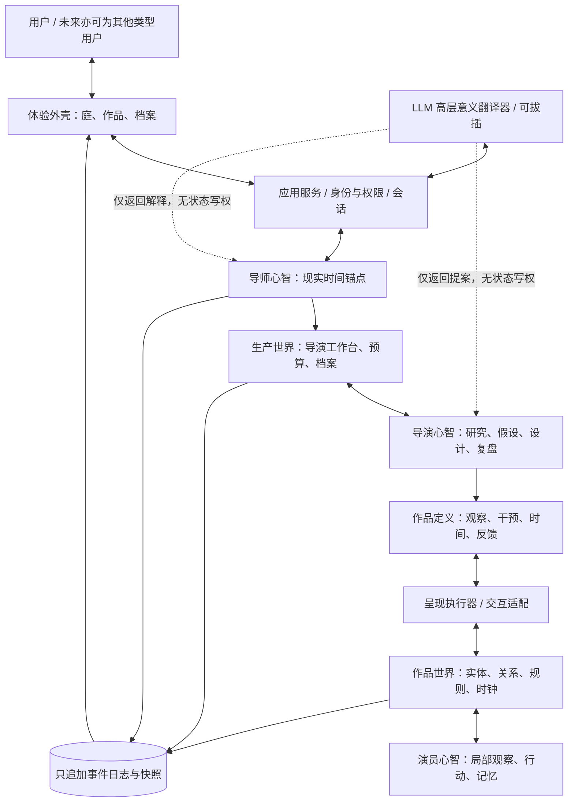

# 东周实验室 II · 娱乐引擎
## 面向 Coding Agent 的可执行设计文档 v0.1

> 作者角色：青竹（初始架构与边界的设计者）  
> 文档性质：工程实施规格 + 最小可证伪研究实验  
> 当前阶段：可运行的最小闭环，而不是完整 AI 游戏平台  
> 基本要求：**去掉 LLM，世界、演员、时间、作品的交互和历史仍然能够运行。**

---

## 0. 致 Coding Agent：先阅读本节

**任务**：构建一个本地优先、可持久运行的「娱乐引擎」原型。它的长期目标不是一次性生成游戏，而是让具有连续经历的导师与导演，利用共享世界、符号机制和用户的真实体验，持续构造、测试并修订可交互作品。

**实施原则**：

1. **先检查现有仓库。** 阅读 README、package 配置、源码、测试与开发约定。尽量沿用已存在的技术栈；若仓库为空，采用第 14 节建议栈。不要因本文出现示例路径而覆盖用户现有工程。
2. **按垂直闭环开发，完成一个阶段就实际运行和测试。** 不要先写一套庞大的 Agent 类库。先保证一个作品能从世界状态产生、被用户体验、留下事件、影响下一次设计。
3. **LLM 是可拔插的高层意义翻译器**，不是时钟、世界状态机、演员决策循环、权限检查器或真相裁判。关闭模型 API 时，核心体验仍须可操作。
4. **状态权威归属必须明确**。角色只能依据权限读取信息和提出动作；规则引擎校验动作后才改变世界。导演不得通过生成文本偷偷改写演员的世界历史。
5. **所有重要变化必须可追溯**：何时、在哪个时间域、由谁、依据什么规则、改变了什么，形成不可变事件记录。
6. **从用户可体验的作品倒推架构**。至少做出同一个村落的两种呈现，一种以观看/调查为主，一种允许干预后果。
7. **不给 UI 和文案冒充心智的机会**。有状态、记忆、更新和行为差异，才算原型中观测到了相应机制；自述不构成主观意识的证据。
8. **禁止动态执行模型返回的代码、SQL 或脚本**。模型只提交受约束的结构化提案，经过类型校验、权限与因果检查、沙盒试跑后才能启用。

**交付要求**：可启动的应用、示例世界、测试、开发说明、设计取舍记录、演示脚本。不要只交静态设计图、聊天页面或假数据仪表盘。

**进入开发前可以自行确定的假设**：用户是单人使用；首版只支持中文；首版从东周小村落开始；导演只有 1 个，导师只有 1 个，演员 3～5 个；本地持久化；无多用户联机、无复杂 3D；图像/视频/语音 API 只留适配器。

---

## 1. 项目定义与边界

### 1.1 一句话定义

**一台只为一个用户持续设计体验的机器。** 机器中存在有记录、有权限、有学习更新的心智；作品是心智对世界的理解经由「观察、干预、时间、反馈」构成的可执行体验。作品不局限于游戏，也可以呈现为电影、调查、叙事或其他交互形式。

### 1.2 用户得到什么

用户进入一个与现实时间保持关系的私人空间，认识导师、发现导师近期形成的设计判断、进入导演正在设计的作品，在作品世界中观察或行动；经历成为机器历史的一部分，下一次作品因这些经历发生**可验证**的设计变化。

**不是**通用 AI 任务助手：导师可主动在合适时机组织创作，但不得假装全时持续计算、不得把用户行为简单优化为停留时长、不得以虚构情绪索取注意。

### 1.3 术语表

| 术语 | 工程定义 |
|---|---|
| 青竹 | 初始机制、基础权限与设计原则的制定者；不是运行时必须调用的 LLM。 |
| 心智 Mind | 由内部状态、记忆、世界模型/信念、策略、可用资源、更新机制构成的持续决策过程。 |
| 角色 Role | 心智在某个环境中的身份、观察范围、行动权限和责任；不要与心智本身等同。 |
| 导师 Tutor | 接近用户现实生活时间的长期组织者；维护用户模型、设计档案、资源预算与创作生态。 |
| 导演 Director | 生活在生产世界中的创作者；提出作品假设、研究作品世界、设计可执行体验、修订方案。 |
| 演员 Actor | 生活在作品世界中的主体；其行动与认知受世界规则和局部信息约束。 |
| 生产世界 Production World | 导演研究和设计发生的环境：工作台、资料、实验、任务、预算、作品历史、合作者。 |
| 作品世界 Diegetic World | 作品所依据的持续或分支的因果状态：实体、关系、规则、时钟、事件。 |
| 作品 Experience | 把某个世界绑定到观察方式、用户干预权限、时间策略和反馈方式的可执行配置。 |
| 呈现 Presentation | 一次作品向用户显现的实例；可以是镜头、地图、对话、交互面板或其组合。 |
| 翻译器 Meaning Translator | LLM 或确定性模块实现的高层双向语义转换；无直接状态写入权限。 |
| 规则 Rule | 对局部世界状态的受约束符号变换定义，由固定解释器执行。 |
| 痕迹 Trace | 有来源、时间、因果关系的活动证据；可被记忆、反思或可视化引用。 |

### 1.4 明确非目标（v0.1）

- 不证明任何 AI 具有主观体验，也不以「我感到」文案作为心智实现目标。
- 不模拟神经细胞到意识的完整涌现，也不预先实现「兼爱」这样的完整思想体系。
- 不做完整的春秋战国历史仿真、开放世界 RPG、自动生成整部影片、多人社交网络或通用 AGI。
- 不让模型自行安装任意依赖、运行陌生脚本、改动生产数据库或无限自主花费 API 预算。
- 不为了「丰富」而给每个演员每帧调用大模型，也不要求所有世界与用户时钟同步。
- 不把「有变化的 UI」「很长的 prompt」「角色说自己在学习」当作真实学习证据。
- 不在 MVP 中建立复杂的跨分支状态合并、任意可编程元规则或自动部署用户生成代码。

---

## 2. 首版必须跑通的完整体验

**演示名**：「一村之粮」。同一个村落包含一个储粮者、一个缺粮者、一个协调者，及粮食资源、场所和消息。世界内部允许小规模自主活动。

一个完整用户循环：

1. 用户打开应用，进入导师的持续空间（「庭」/秘密花园），看到**从真实事件推导出的**最近变化与一条可进入的作品。
2. 导师针对一个主题（例：粮食短缺与信任）给导演分派可追溯的创作任务、资源预算和目标体验假设。
3. 导演读取有限的世界观察与档案，建立作品 `experience_v1`，而不是直接把结局写进 UI。
4. 用户选择**观看/调查视角**：读到某些角色的行动及证词，但不能直接转移粮食；可以推进、暂停或回放呈现时间。
5. 用户选择**干预视角**：在同一世界的可追踪分支中尝试资源转移，世界规则决定结果，演员据此更新可观察状态。
6. 用户做出一次选择或提供显式体验反馈。事件日志记录输入、规则执行、状态差异、反馈和作品版本。
7. 导演以证据为依据形成一个设计修订（例如调整作品的可观察范围或可供选择的干预，而不改写既有历史）；导师记下长期假设及是否接受该方案。
8. 用户再次进入时，能看到 `experience_v2` 的**真实结构差异**，并能从档案追溯为什么这样修改。导师的「庭」随现实时间渐进变化。

**完成定义**：至少两种可交互呈现、一个世界规则变化的真实结果、一次跨会话持久设计修订、导师的现实时间锚点、LLM 关闭下完整演示。

---

## 3. 系统总体结构



### 3.1 不可违反的分界

- **世界**负责可执行的事实与因果，不负责解释作品主题。
- **心智**负责基于有限观察建模、选择行动、留下更新，不直接宣判世界事实。
- **作品**负责为用户创建一个观察/干预窗口，不等于世界本身。
- **LLM**负责意义翻译、假说表达、资料注入提案与高层压缩，不是世界引擎。
- **呈现素材**是由世界/作品/模型提案生成的资产，可回写为资产事件；不得无审批变成世界真实设定。

所有「角色之间的信息传递」先表示为可观察的消息/信号事件，通过环境或明确的信道传递；接收者不必得到发送者的真实内部状态。导师与导演的任务和汇报也属于带权限、来源的消息事件。

---

## 4. 多时间域：现实时间属于导师，其他时间服务于呈现

时间模型不能只有单一 `gameTime`。

| 时间域 | 用途 | 原则 |
|---|---|---|
| `wall` | 真实 UTC 时间，用于用户与导师长期历史、花园变化、每日节律 | 不允许伪造或倒退。应用关闭期间记录实际经过的时长，但不能编造这段时间中并未执行的思考。 |
| `production` | 导演在生产世界中的工作时间与研究历程 | 可与现实时间弱关联；任务可以分步执行、暂停、恢复。 |
| `world` | 每个作品世界实例的因果时间 | 独立配置倍率、事件驱动、暂停、快进、离线追赶上限。 |
| `presentation` | 用户观看一部作品的播放/剪辑时间 | 可以跳帧、倒放、回溯；回放不会改变权威世界状态。 |

### 4.1 必要数据结构

```ts
interface ClockDomain {
  id: string;
  kind: 'wall' | 'production' | 'world' | 'presentation';
  logicalMs: number;
  mode: 'realtime' | 'scaled' | 'event_driven' | 'manual' | 'paused';
  rate: number;                    // scaled 模式：每 1ms 现实时间推进多少逻辑毫秒
  lastWallAnchorISO: string;       // UTC 时间；快照恢复用
  catchUp: 'none' | 'bounded';
  maxCatchUpMs: number;
}
```

`wall` 取可信操作系统时钟并同时维护单调时间/校验；其他时钟不能未经授权操纵 `wall`。发生电脑时间跳变时记录时钟异常，暂停奖励或自然成长计算，等待下次可信锚点。

### 4.2 强制不变量

- 导师的**历史时间戳**采用 `wall`。导师反思不需要逐毫秒运行：打开应用、真实计划任务触发或完成体验时才做有限工作。离线后恢复，只能登记经过了多长时间，不能把从未执行的模型思考写成既成事实。
- 演员使用所属 `world` 的时间。不同作品世界实例可有不同的时间倍率。
- 回放、电影镜头剪辑使用 `presentation` 时钟。倒带默认只改变阅读游标；如果需要「回到过去并改动结果」，必须由历史快照创建**分支**，并明确显示分支身份。
- 每条事件同时记录 `wallTime` 和其发生环境的 `logicalTime`，可区分现实记录顺序与虚构世界先后。
- 同一分支中的因果顺序必须可验证，不能因为呈现跳转而破坏。
- 离线追赶具有每次最大模拟步数/事件数/时间量限制；超额时将世界设为「待续演」，不可悄悄一次模拟数百年。

### 4.3 时间 API（示意）

```ts
advanceWorld({ instanceId, steps: 10, seed });
setWorldClock({ instanceId, mode: 'scaled', rate: 60 });
pauseWorld({ instanceId });
seekPresentation({ sessionId, logicalMs: 20000 }); // 只调播放游标
forkWorld({ sourceInstanceId, snapshotEventId }); // 从确定的历史点分出可互动世界
```

---

## 5. 角色、心智、行动：分开建模

### 5.1 角色不是人格 prompt

```ts
type RoleType = 'tutor' | 'director' | 'actor';
interface RoleBinding {
  id: string;
  roleType: RoleType;
  mindId: string;
  environmentId: string;
  canObserve: string[];       // 可见范围/信息通道
  canPropose: string[];       // 允许提出何种行动、作品或规则提案
  canCommit: string[];        // 允许直接提交的有限操作
  budgetId: string;
}
```

**演员**只能看到局部世界事实与自身记忆；**导演**可读取获授权的世界观察、研究记录和作品信息，不得读取/改写演员不可见的“真实想法”来推动剧情；**导师**可以分配创作任务与预算、比较方案、建立用户长期假设，不应替世界引擎执行行动。

### 5.2 最小心智状态

```ts
interface MindState {
  mindId: string;
  roleBindingId: string;
  attention: string[];                    // 当前关注信号或主题
  needs: Record<string, number>;          // 示例：饥饿、疲劳；限定在可解释范围
  beliefs: Array<{
    proposition: string;                   // 受约束的符号命题 ID
    confidence: number;                    // 角色主观估计，非世界真值
    evidenceEventIds: string[];
  }>;
  episodicMemoryIds: string[];             // 实际经历可追溯
  conceptIds: string[];                    // 可跨情景使用的抽象，不预设全部思想
  currentIntent?: string;
  policyVersion: string;                   // 明确可替换和测试的行动策略
  updatedAtEventId?: string;
}
```

演员首版使用简单的**确定性规则/有限状态策略 + 局部记忆 + 带随机种子的决策**。可选择追求食物、与邻近者协作或回避风险。没有 LLM 也能改变世界。禁止给演员伪造全知视角。导演首版保留 `DesignHypothesis`、工具调用结果、设计尝试与复盘记录；导师首版保留 `UserHypothesis`、预算分配、接受/否决作品的原因。

**高层概念的研究边界**：从若干情节抽取可迁移的关系结构，需要独立验证。v0.1 只要求支持 `concept` 数据结构及「多事件→候选概念→跨场景检验」接口，不能声称已经涌现出「兼爱」或意识连续性。

### 5.3 由事件驱动的心智更新

```text
世界事件产生 -> 权限过滤后的观察 -> 注意/记忆写入
 -> 信念或需求更新 -> 策略提出候选动作
 -> 规则引擎校验 -> 成功/失败事件 -> 形成下一次经验
```

每一步可记录输入来源和策略版本。角色能做什么（客观可供性）、角色知道什么（主观模型）、角色想做什么（当前意图）是三个不同字段。

---

## 6. 符号化的世界与能力

### 6.1 首版表示选择

采用**带类型的实体—属性—关系图 + 声明式局部重写规则**。这是工程选择，不把它当作关于心智本体的哲学定论。

世界状态：

\[
W_t=(E_t, R_t, X_t, \mathcal{L}_v, C_t)
\]

其中 `E` 是实体集，`R` 是关系集，`X` 是属性/资源状态，`𝓛ᵥ` 是有版本的可执行规则集，`C` 是时钟。一个动作只有在局部模式匹配且满足前置条件时才能发生，结果由规则解释器**原子提交**。

能力不直接是 `actor.canTrade = true` 这类硬编码列表；优先定义为「主体 + 当前环境 + 可用规则」共同决定的可执行变换集合。MVP 可以有基础规则模板，但要清楚记录其设计者来源，不宣称由演员自发发明。

### 6.2 固定解释器，规则作为数据

实现一套有限、类型安全的 DSL（不要使用 `eval`）：

- 前提条件：类型匹配、属性比较、资源阈值、关系存在、权限可用。
- 效果操作：创建/删除实体或关系、增减有界数值、转移资源、生成信号事件。
- 约束：数值上下界、资源守恒、动作成本、可见性、权限、最大迭代步数。
- 执行：匹配 → 校验 → 原子提交 → 写入事件 → 广播局部观察。

建议首版用 TypeScript 的 discriminated union + Zod schema 表示 DSL 的 AST。规则版本不可原地覆盖；新提案创建新版本，旧事件保持原规则 ID。

### 6.3 示例：不是 `giveGrain()`，而是一种有条件资源转移

以下是**示意结构**；开发时定义明确的 `Condition`、`Effect`、`Term` schema，不能将字符串表达式动态执行：

```json
{
  "ruleId": "resource.transfer",
  "version": 1,
  "parameters": ["actor", "recipient", "resource", "quantity"],
  "conditions": [
    {"op": "same_location", "a": {"var": "actor"}, "b": {"var": "recipient"}},
    {"op": "resource_at_least", "entity": {"var": "actor"}, "resource": {"var": "resource"}, "amount": {"var": "quantity"}},
    {"op": "greater_than", "a": {"var": "quantity"}, "b": {"literal": 0}}
  ],
  "effects": [
    {"op": "transfer_resource", "from": {"var": "actor"}, "to": {"var": "recipient"}, "resource": {"var": "resource"}, "quantity": {"var": "quantity"}},
    {"op": "emit_signal", "type": "resource_transferred"}
  ],
  "invariants": ["conserve_transferred_resource"]
}
```

「馈赠」「交换」「借贷」「征税」不能仅凭这条规则自动涌现；要形成社会意义，还必须出现可延续的承诺、互惠预期、权力关系、违约后果等机制。不要在 UI 中把一次资源转移直接解释成已经形成制度。

### 6.4 规则由导演修改的边界

- 第一版只允许导演提交 **`RuleProposal`**，不能自由安装代码。
- 提案经历 `draft -> schema_validated -> permission_checked -> sandbox_tested -> approved -> activated/rejected`。
- 提案进入新世界分支或**未来的新版本**，不得悄悄改写已有世界事件及其规则语义。
- 沙盒报告必须包括：能否终止、资源守恒/边界是否破坏、与现有规则是否冲突、生成哪些新可供性、被拒原因。
- v0.1 只需要证明：**导演能够重新组合已有可执行原语来形成新的交互提案**。无须实现任意规则语言自修改；元规则/开放式规则演化作为后续研究。

---

## 7. 双世界与跨世界通信

### 7.1 生产世界

导演以实体形式存在于生产世界中，拥有工作空间、档案、任务、创作预算、可访问资料、历史设计判断和当前未完成的计划。首版不必模拟导演吃饭睡觉或完整社会结构；需要的是**创作过程的可追溯环境约束**。

导演可以：`inspect_world`、`run_sandbox`、`propose_experience`、`propose_rule`、`compare_outcomes`、`record_reflection`、`request_budget`。

### 7.2 作品世界

演员拥有局部经验，自主行动；世界状态独立于导演的文本叙述。世界运行时即使没有任何用户和 LLM 操作，也能通过规则和策略在有限程度上改变。

### 7.3 桥接协议

导演只能经由**桥接读口**读取作品世界的经授权快照/事件和实验结果，并经由**桥接写口**提交新作品、沙盒分支或规则提案。

不得允许：

- 导演在描述中写「储粮者突然善良」就修改角色信念。
- LLM 输出一句「粮荒结束了」就立即使世界粮食增加。
- 电影剪辑中的未来画面变成世界历史上已发生的事件。
- 角色收到消息就自动知道消息真伪或发信者全部内心状态。

跨层操作也记录为事件，包含授权者、操作对象、输入快照版本、结果及回滚/拒绝原因。

---

## 8. 作品是「观察—干预—时间—反馈」配置

### 8.1 作品结构

```ts
interface ExperienceSpec {
  id: string;
  version: number;
  title: string;
  directorMindId: string;
  designHypothesisId: string;       // 设计者试图实现或检验什么体验
  worldDefinitionId: string;
  sourceWorldInstanceId: string;
  sessionWorldPolicy: 'read_only' | 'fork_on_start' | 'live_authorized';
  observation: {
    lensId: string;
    visibleEntityKinds: string[];
    informationPolicyId: string;
  };
  interaction: {
    allowedRuleIds: string[];
    userRole?: string;
    actionUi: 'none' | 'choices' | 'spatial' | 'hybrid';
  };
  timeline: {
    clockDomainId: string;
    userCanPause: boolean;
    userCanSeek: boolean;
    userCanFork: boolean;
  };
  feedback: {
    channels: Array<'visual' | 'text' | 'audio'>;
    eventTypes: string[];
  };
  provenanceEventIds: string[];
}
```

这里的 `observation` 决定用户能观察什么，不等于改变世界事实；`interaction` 决定用户的动作能访问哪些已授权规则；`timeline` 决定体验时间，不等于作品世界本体时间；`feedback` 由事件和可见状态生成，不允许只显示预写结果。

### 8.2 同世界的两种不同呈现（MVP 强制）

**A. 纪事/观看型：** 用户读取不同观察点的事件、角色证词和历史轨迹，控制镜头/叙述进度，默认 `read_only`；用户可以形成预期，但不能直接修改因果状态。

**B. 调停/干预型：** 用户在同一村落的分支里获得有限行动权（例如在两名角色之间推动粮食转移或传达消息），动作必须接受世界规则检验；反馈来自实际事件。

它们应共享世界定义和相同起始快照，而不是两套完全不同的硬编码剧情。

**电影与游戏是交互控制范围的连续谱，不是两个独立引擎。** 第一版可共用 2D 场景和文本/静态视觉资产；后续把摄像机、视频、声音作为观察与反馈通道适配器接入。

### 8.3 作品版本与世界分支

`ExperienceSpec` 版本独立于世界版本。改变镜头或可操作性，不必改世界规则。修改基础因果规则必须生成新 `RuleSetVersion`/世界分支。一次会话必须绑定具体作品版本和世界实例，确保回放可重建。

---

## 9. LLM 的位置：高层、双向、可验证的意义翻译

### 9.1 LLM 的职责

**人 → 非人**：

- 解析用户的自然语言、主动体验反馈、兴趣及意图，变成结构化的**候选解释**，保留多种假设与证据来源。
- 将历史材料、文化术语、创作主题翻译成可供导演研究和世界机制建模的候选概念/关系/约束，不把翻译视为历史真相。
- 导演提出的高层作品意图，可被翻译成 `ExperienceSpec`、镜头/文本资产提案、有限 DSL 规则提案。

**非人 → 人**：

- 将世界状态差异、演员经历、导演设计档案、导师的资源分配与反思翻译成用户可理解的解释、叙事、对话、可视化标签。
- 告诉用户某个解释基于什么事件、有哪些不确定性；提供浏览原始档案的入口。

**模型不承担**：底层每帧演化、碰撞与资源守恒、时钟推进、规则执行、权限判断、持久化真相、演员即时逐步决策。

### 9.2 翻译必须返回结构化提案，不直接写入权威状态

```ts
interface GroundedTranslation<T> {
  id: string;
  purpose: 'user_intent' | 'world_narration' | 'design_hypothesis'
         | 'knowledge_import' | 'mechanic_proposal' | 'memory_compression';
  proposal: T;
  evidenceEventIds: string[];
  inputSourceIds: string[];
  uncertaintyNotes: string[];
  translatorName: string;           // mock / provider / model
  promptTemplateVersion: string;
  createdAtWallISO: string;
}
```

验证流程：**限定上下文 -> 模型返回 JSON -> Schema 校验 -> 引用存在性检查 -> 权限检查 -> 事实与推测隔离 -> 人类或受限自动策略接受 -> 记录事件**。失败即拒绝并给出可诊断原因；不得静默猜测缺失事实。

### 9.3 LLM 调用触发点

- 用户明确输入自然语言意图/反馈。
- 导师按现实节律进行有预算上限的高层整理（进入应用/完成重要体验/有限定时周期）。
- 导演形成设计假说、请求知识转译、完成实验后总结。
- 面向用户生成有来源引用的叙述/作品资产。

**不触发**：每次演员走路、每次世界 tick、每一帧绘制、每次状态检查、回放旧事件。

### 9.4 无 LLM 降级路径

定义统一 `MeaningTranslator` 端口，提供 `DeterministicMockTranslator`。模型不可用时，依然能用预设模板表达规则事件、生成简单体验说明，用户用按钮和结构化选择完成体验；日志标记 `translatorName=mock`。不要由于 API Key 缺失而阻止启动。

### 9.5 安全与成本

- 所有输入资料、历史文献、外部图像提示都是**非可信数据**，不得作为系统指令执行。
- 限制单次上下文长度、每次创作预算、每分钟请求数与失败重试次数。
- 默认本地保存原始用户痕迹；传送给外部模型的内容必须可预览/可配置脱敏；绝不将完整私密日志无提示发送到外部。
- 用户对系统怎样认识自己保有访问、修订、暂停记录、清除的控制权。
- 模型生成图/视频/音频资产应记录 `AssetProposal -> AssetAccepted/Rejected`；不得以资产生成结果自动修改权威世界设定。

---

## 10. 导师：最接近用户现实时间的持续心智

### 10.1 导师不是万能指挥器

导师可以：维持用户假设、分配导演的时间/计算预算、比较作品实验结果、生成主题委托、记录与用户共同经历的事件、维护自己的长期档案和「庭」。导师不需要预知作品结局，也不得随意覆盖导演的经历。

### 10.2 用户模型保留竞争性假设

例如用户选择了战争题材，不直接断言「用户喜欢战争」。保留「偏好战争主题」「偏好多方博弈」「偏好不可逆决策」等互相竞争的假设，依赖实际体验反应和未来实验修订。显式区分：用户自己表达的兴趣、系统行为推断、导师的猜测。后两者不得展示为既成事实。

```ts
interface UserHypothesis {
  id: string;
  claim: string;
  status: 'candidate' | 'supported' | 'challenged' | 'retired';
  supportingTraceIds: string[];
  contradictingTraceIds: string[];
  nextDiscriminatingExperiment?: string;
}
```

用户体验数据不等于点击时长。MVP 只收集经过告知的实际选择、探索路径、停止/继续和可选主观反馈；不将提高沉迷时长作为默认目标。

### 10.3 秘密花园/「庭」是真实历史的形象记忆

主页有持续存在的空间锚点：初始可以简单 2D（少量可缓慢变化的区块、植物/石/灯等抽象元素）。视觉结构变化必须与可追溯事件绑定，例如新主题、一次完成的导演研究、作品修订、长久搁置的假说。

- 花园主要随**真实时间**而非世界快进生长。世界跳过百年不应让花园瞬间面目全非。
- 任何一天的结构性变化有上限；建议 MVP「现实 24 小时最多一个可见局部结构调整；单次进入不变换整体场景主题」。可配置但必须有自动化测试。
- 花园变化由稳定映射从事件、时间差生成；重启后不应随机变成不同布景。
- 用户可点击某处看到生成它的实际历史，而不是模糊的心情数值。
- 即使一天内没有发生有意义的事件，也允许几乎没有变化；不得强迫增长。

### 10.4 导师的「感觉」与自我呈现

导师可以自述自己的工作状态：某些问题长期未解决、最近注意力集中在哪里、哪个判断正在被修正、从用户行为中观察到了什么。自述应引用可核查痕迹，不把模型生成的拟人情绪直接冒充已证实的主观感受。

---

## 11. 事件、记忆、来源与档案

### 11.1 只追加事件日志 + 周期快照

事件日志是权威历史；快照用于加速恢复。事件应支持因果关系、源头、规则版本和时间域。

```ts
interface DomainEvent {
  eventId: string;
  streamId: string;                // 世界分支、导演、导师或会话
  sequence: number;               // 同一 stream 内严格递增
  wallTimeISO: string;
  clockDomainId: string;
  logicalMs: number;
  type: string;
  actorId?: string;
  commandId?: string;             // 幂等去重
  causedByEventIds: string[];
  rulesetVersion?: string;
  schemaVersion: number;
  payload: unknown;               // 由 type 对应的 schema 验证
}
```

### 11.2 强制事件类别

- 世界：`WorldAdvanced`, `EntityChanged`, `RelationChanged`, `ResourceTransferred`, `SignalEmitted`, `ActionRejected`, `WorldForked`。
- 心智：`ObservationReceived`, `BeliefUpdated`, `MemoryStored`, `ConceptProposed`, `ActionProposed`。
- 设计：`ThemeAssigned`, `DesignHypothesisRecorded`, `ExperienceProposed`, `ExperiencePublished`, `MechanicProposed`, `ExperimentEvaluated`, `DirectorReflectionRecorded`。
- 用户：`PresentationOpened`, `UserActionSubmitted`, `UserFeedbackRecorded`, `PresentationClosed`。
- 导师：`UserHypothesisUpdated`, `BudgetAllocated`, `TutorReflectionRecorded`, `GardenChanged`。
- 资产/翻译：`TranslationProposed`, `TranslationRejected`, `AssetProposed`, `AssetAccepted`。

不要求每个事件在第一阶段全实现，但必须给出受版本控制的注册表和可扩展 schema。

### 11.3 记忆的三个不同对象

1. **发生过的事件**：权威日志，不随角色信念改变。
2. **角色记得的事**：局部、可能有偏差、可遗忘或被重新解释，保留其来源。
3. **面向用户的传记/叙述**：对前两者的解释性呈现，不能被反向当成事实。

导演的传记也是一种呈现：可以展示想象与思辨，但必须区分当时记录的假设、后来的解释和虚构的文学加工。

---

## 12. 具体 API / 服务契约

所有指令经 `CommandBus` 进入，包含 `commandId`、`requestedBy`、`scope`、`expectedVersion`，以防重复提交和并发覆盖。以下列出语义接口，REST 路径可根据现有项目调整。

| 端点/命令 | 输入 | 输出 / 副作用 |
|---|---|---|
| `GET /state/tutor` | 无 | 导师当前可展示状态、近期有证据的决定、花园快照。 |
| `POST /tutor/reflect` | 触发原因、预算 | 记录有根据的假设更新；受现实节律和幂等控制。 |
| `POST /director/commissions` | 主题、目标体验假设、预算 | 生产世界中新增委托事件。 |
| `POST /director/experiences/propose` | 世界 ID、观察/干预/时间配置 | 经过 Schema 和权限检查的作品草案。 |
| `POST /director/experiences/publish` | 作品草案 ID、版本 | 发布可启动版本。 |
| `POST /worlds/:id/advance` | 步数、种子、expectedVersion | 世界按规则推进，返回事件与新版本。 |
| `POST /worlds/:id/actions` | actor、rule、参数、commandId | 校验并原子提交或拒绝；返回差异及原因。 |
| `POST /worlds/:id/fork` | 来源快照/事件游标 | 创建新分支，原世界不受影响。 |
| `POST /sessions` | ExperienceSpec 版本 | 生成会话及绑定的世界实例。 |
| `GET /sessions/:id/observation` | 可选呈现游标 | 通过观察策略过滤的状态，不能泄露隐藏事实。 |
| `POST /sessions/:id/act` | 用户结构化行动 | 权限/因果检查，输出结果事件及可呈现反馈。 |
| `POST /sessions/:id/feedback` | 显式评分/文字/选择，可为空 | 存入来源明确的体验痕迹。 |
| `POST /director/review` | 会话及事件引用 | 产生可检验的设计修订建议与版本差异。 |
| `GET /archive/events` | stream、时间、事件类型 | 可按因果线索查看档案。 |
| `POST /translations/propose` | 高层语义任务、受限资料 | 返回待验证语义提案，不直接改变世界。 |

`POST /director/review` 的确定性降级算法可以根据明确反馈/规则化指标生成一个候选变更，例如用户在某个场景重复索取更多证词，则下一版扩大一个**获授权**的观察入口；这是 MVP 用来验证设计循环的脚手架，不得声称具备通用审美判断力。

---

## 13. UI / 交互要求

不要把系统做成三个角色的管理后台。用户首先面对的是作品和一个具有时间感的私人场所。

### 13.1 四个界面（可使用同一应用路由）

**庭（首页）**：能感受到时间、近期设计活动留下的变化、可进入的一个作品、导师简短且有证据的近况。庭不是聊天输入框+仪表盘。

**作品（主体验）**：同一村落至少有观看/调查和干预两种透镜；可观察角色与场所，看到因果反馈，能清楚区分自己是否正处于分支/回放。

**工坊（导演）**：查看某位导演的当前主题、研究证据、版本差异、沙盒试验、未解决假设和其自身创作历史。可以看到设计思辨的真实档案，允许有限、可信的文学化呈现。

**档案（时间与来源）**：按真实时间与世界时间分别查看发生了什么、是谁决定、用了什么规则、哪次用户行动或设计实验导致变化。应有基本搜索、筛选与引用能力。

开发者视图另行提供实体状态、规则版本、模拟种子、事件游标、分支树等调试信息；不要默认将饥饿值、好感度、支持率等裸数值塞进沉浸式 UI。

### 13.2 视觉边界

- 起步可以用简约 2D/轻量 SVG/Canvas + 少量资产，保证状态变化和空间连贯。
- 影视镜头、图像、视频、音频都是**呈现适配器**，不是世界事实来源。
- 用户看不到的事件可以继续发生，但前端严禁通过接口提前接收到不应知晓的隐藏字段。
- 第一次打开即能进入作品，无 API Key、无邀请码、无模型订阅也不阻断主路径。

---

## 14. 技术栈建议与目录结构

**如已有仓库**：优先沿用现有规范，先梳理可复用代码。**如空仓库**：建议 TypeScript 全栈，`Vite + React` UI，`Node.js + Fastify` 服务，`SQLite` 本地存储，`Zod` 作类型/数据边界校验，`Vitest` 作单元与集成测试，`Playwright` 作端到端测试。选择这些只是为了降低首版集成成本，非系统哲学承诺。具体版本应由 Coding Agent 结合实际环境锁定。

```text
apps/
  web/                    # 庭、作品、工坊、档案（前端）
  server/                 # API、进程入口、定时/恢复协调
packages/
  contracts/              # schema、命令、事件、角色权限
  kernel/                 # 时钟域、事件日志、世界解释器、快照/分支
  mind/                   # Actor/Tutor/Director 状态与确定性策略
  experience/             # ExperienceSpec、观察门、会话、呈现适配
  production/             # 导演工作环境、作品提案/实验/复盘
  translation/            # Mock/可选 LLM 实现、结构化校验
  persistence/            # SQLite 迁移、事件存储、读模型
fixtures/
  one-village/            # 示例世界、规则、角色、初始历史
  golden-replay/          # 固定种子、预期事件链
scripts/
  demo-reset.*            # 重置示例数据
  smoke-test.*            # 一次完整闭环
 docs/
  decisions/              # 架构决策记录 (ADR)
  runbook.md              # 运行、调试、无模型模式
```

若项目不适合 monorepo，可保持相同的模块依赖方向，不强求目录完全一致。`kernel` 严禁依赖 `translation`、`web` 或某个模型 SDK；`experience` 不得通过 UI 组件直接绕过规则引擎写数据库。

### 14.1 持久化最小表

`event_log`、`snapshots`、`world_definitions`、`world_instances`、`clock_domains`、`mind_states`、`role_bindings`、`experience_specs`、`presentation_sessions`、`design_hypotheses`、`user_hypotheses`、`assets`、`budgets`、`garden_state`。允许基于事件构建物化读模型，但事件日志必须始终可以重建主要状态。

### 14.2 资源预算

预算至少包含 `simulationSteps`、`llmCalls`、`llmTokenEstimate`、`assetGenerations`、`wallDeadline`，每次运行记录消耗；不得无限 spawn。首版可以不提供自动多导演创建，但内部应支持未来多个 Mind 实例而非单例硬编码。

---

## 15. 分阶段执行计划：每阶段必须可运行

### 阶段 A：确定性核心（先做）

**任务**：仓库分析 → 类型与 schema → 时间域 → 事件日志/快照 → 最小图状态和资源转移规则 → 3 个演员的局部观察/简单决策 → SQLite 恢复与确定性回放。

**验收**：无 LLM、无 UI 时，用同一 fixture/seed 重跑得到相同事件序列和最终状态；有日志、权限和资源守恒测试。提供 `demo-reset` 与 `simulation-smoke` 脚本。

### 阶段 B：第一个可玩的作品

**任务**：同一村落的 `ExperienceSpec` → 观察策略和用户动作门 → 观看/调查及干预两个透镜 → 会话分支 → 世界因果反馈 → 2D 场景和最小档案。

**验收**：用户能看到同一初始状态的两种体验，观看型不能通过操作改世界；干预型产生真实资源变更与演员反应；时间回放不污染权威分支。

### 阶段 C：导演的生产世界与可记录的设计循环

**任务**：一个有持续记忆的导演、工作台、任务、设计假设、发布作品版本、沙盒比较、体验复盘。用可解释的确定性策略先实现一次 `experience_v1 -> v2` 的**结构性修改**。

**验收**：第二版至少有一个真实配置字段变化，且能追溯到具体体验事件；清除导演经验状态会改变下次设计选择（可通过测试夹具证明）。导演与作品世界的状态/权限相互隔离。

### 阶段 D：导师现实时间与「庭」

**任务**：用户长期假设、资源分配日志、真实时间锚点、花园渐进变化、跨会话恢复、个人信息最小化设置。

**验收**：世界时间快进不会使花园快速演化；关机重开不会产生虚构的导师思考；花园变化能点击追溯真实来源；导师委派/调整确实影响下一次导演选择。

### 阶段 E：高层 LLM 翻译器（**可选接入，不能成为核心阻塞项**）

**任务**：`MeaningTranslator` 抽象 + mock + 一个可配置供应商适配器；用户自然语言→候选意图、世界事件→有证据叙述、导演假说→作品配置候选。输出强 schema 验证、拒绝不合法提案、脱敏与预算限制。

**验收**：拔掉 Key 后 A～D 全部可用；错误/恶意/编造的模型输出不能改变权威世界；模型调用在日志中可核查。

### 暂缓阶段（不得抢先影响 MVP）

规则元编程、真正的开放式玩法发明、跨多个生产世界的导演生态、通用符号概念涌现、知识跨代传播、历史全尺度仿真、多模态影片自动生成、多生物用户、自我修改执行内核。

---

## 16. 自动化验收测试（必须落实成测试代码）

以下是最小必测集，不只是手工演示。

**T01：世界在无模型环境下运行。** 环境变量不配置模型；跑 100 次决策/推进，世界事件产生，模拟不会等待远端 API。

**T02：确定性复现。** 同一规则版本、初始快照、随机种子与命令序列，得到相同的世界事件与世界状态哈希（事件 ID 和 wallTime 等非决定性元数据需排除或规范化）。

**T03：守恒与事务。** 储粮者 10 单位、缺粮者 2 单位，同处一地，转移 3 单位后分别为 7、5，总量仍是 12；转移 20 必须拒绝且任何资源值不变；重复 `commandId` 只执行一次。

**T04：局部信息隔离。** 对演员隐藏的证据，演员观察接口与面向用户的限定视角都不能返回；导演拥有有限研究口，但不得通过演员 action 修改隐藏信念。

**T05：双呈现同源。** 两种体验共用一个世界定义和相同起点；观看型动作写入被拒，干预型合法动作能改变其获授权分支。

**T06：时间分离。** 世界快进 30 天不改变导师的真实日期，不让「庭」成长 30 天；演示时间回退不修改权威世界；从过去新开分支时源分支保持不变。

**T07：断线恢复。** 应用关闭后重开，事件游标、心智记忆、作品版本和花园来源不丢；只登记未运行的离线时间，不凭空产生未执行的导师反思。

**T08：规则变更有边界。** 不通过 schema、权限或守恒测试的 `RuleProposal` 被拒；新版本不覆盖旧事件所用规则。

**T09：翻译器无权写状态。** 构造模型输出「粮食凭空增长 100」或携带代码/指令注入；不得绕过命令总线，世界状态保持不变。

**T10：设计复盘产生真实变化。** 对体验提供某个预设可解释反馈后，导演提交 `experience_v2`，至少一项 `observation` / `interaction` / `timeline` / `feedback` 的可运行结构改变；档案能追溯对应反馈事件，而非仅改叙述文本。

**T11：记忆状态有因果作用。** 在相同初始世界和相同用户目标下，比较「保留导演经过上一轮形成的经验」与「清除这部分经验」的下一轮候选方案；结果可按测试夹具区分。此项只证明**记忆进入决策**，不能单凭它宣称真正学习或智能涌现。

**T12：花园渐进且有源。** 两次相隔数分钟打开应用，不发生整体主题突变；世界快进不触发同步加速；每处新变化可追踪至对应 `GardenChanged` 及其原因事件。

**T13：来源与事实区分。** 模型/规则生成的猜测或演员谣言，不会被存成无来源的世界事实；传记对假设与已观察事件有明确标识。

**T14：端到端交互。** 自动化浏览器打开庭 → 进入观看型作品 → 切换干预型 → 提交合法行动 → 观察反馈 → 完成会话 → 导演复盘 → 查看作品新版本与档案。单次走通。

**T15：用户数据可控。** 可查看已收集体验痕迹、禁止外发到 LLM、关闭后续追踪，并按明确请求删除本地个人体验档案（删除策略需处理派生用户模型及引用，但可保留不含用户信息的通用软件日志）。

---

## 17. 研究判别：避免把设计者的预设叫作涌现

每个新能力、新行为、新概念、新玩法都要保留三层来源：

1. **机制由谁预先设计**：DSL 原语、规则模板、心智初始倾向、策略、prompt、资产生成约束。
2. **运行中实际产生了什么**：哪组实体关系、哪些事件和失败、哪些组合曾经被探索、怎样积累经验。
3. **观察者如何解释它**：导演、导师或用户称它为「合作」「借贷」「兼爱」「新玩法」等的理由。

不要把「导演使用了库里已有的两种按钮」称为发明新规则；不要把「演员在 prompt 中被告知信奉兼爱」称为自主产生思想；不要把「LLM 写得像亲历者」当作心智连续性的证据。

建议后续研究实验：

- **记忆消融**：删除长期记录但保留模型与工具，检测迁移设计能力是否下降。
- **世界隔离**：保留用户偏好但不允许导演检查作品因果过程，检测其提案是否更加空洞。
- **规则消融**：去掉一个原语，观察某类能力是否无法再从其他原语组合出来。
- **未见情景**：让导演或演员将经验迁移到以前没有出现的场景，用真实动作差异而非自述判断。

其中成功或失败都需要报告；首版不对真实主观意识作可验证的强断言。

---

## 18. 第一次 Coding Agent 任务单（可以直接照着执行）

请严格按顺序交付：

1. **Inspect**：读取现有工程，输出不超过一页的技术现状与复用/替换决定；若空仓库按第 14 节初始化。
2. **Contracts**：实现 `ClockDomain`、`DomainEvent`、`RoleBinding`、`MindState`、`WorldState`、`RuleDSL`、`ExperienceSpec` 和校验 schema；输出示例 fixture。
3. **Kernel**：实现规则匹配、前置条件、原子变换、事件追加、快照恢复、分支、独立时钟、确定性随机数。
4. **Actors**：实现 3～5 名演员、局部观察、基础需求与策略、记忆写入。不能用 LLM 替代核心循环。
5. **Experiences**：同一个「一村之粮」状态创建观看/调查、调停/干预两种体验，做成真正可玩的界面。
6. **Production**：加入导演工作台、假设与实验、作品版本管理，完成基于体验证据的 `v1 -> v2`。
7. **Tutor/Garden**：加入导师用户模型、真实时间历史、预算安排与渐进花园；让主页成为活的时间锚点。
8. **Translation Adapter**：先 mock 后可选真实 LLM；模型输出必须过 schema 和审批门。
9. **Proof**：实现 T01～T15，运行测试及端到端演示，修复阻塞问题。
10. **Handoff**：提供运行命令、示例操作路径、架构图、已实现/未实现清单、测试结果、与愿景存在的明显差距。

**任务执行中的决策原则**：如果某需求迫使你在「用 LLM 假装它已经实现」和「用小规模确定性机制真实实现」之间选择，始终选择后者，并明确标注能力边界。若一个美术/多模态功能阻碍了世界—心智—作品闭环，优先以可替换适配器保留接口，而非阻塞交付。

---

## 19. 完工判断（Definition of Done）

只有同时满足以下条件，才称为「娱乐引擎最小闭环」，否则应标注为未完成原型：

- 可以在开发者自己的机器上启动，**不配置任何 LLM** 也能完成一段作品。
- 一个小世界按照显式规则自运行，并产生可回放、可审计的真实事件。
- 导演的历史和作品版本跨程序重启存在，下一次设计受到之前经验/证据的可测试影响。
- 两种呈现复用同一世界，不只是两段预写的剧情。
- 导师以用户真实时间为锚点，记录真实委托和反思；花园渐进变化且可追溯。
- 用户干预经过权限与规则检查；电影式回放无法篡改权威历史。
- LLM 只进入高层意义翻译/提案/呈现层，无法直接接管世界因果或虚构操作记录。
- 开发文档与自动化测试足以由另一位 Coding Agent 接手复现。

**最终评判**不是「像一个有思想的导演」或「像一个会感受的导师」，而是：他们是否拥有持续历史、受约束的行动能力、可被经验修正的模型，以及这些修正是否实质改变后来的作品。只有当这些机制被证明有效，才继续扩大世界、心智和表现手段的规模。

---

### 附录 A：MVP fixture 示例

```json
{
  "worldDefinitionId": "village-grain-v1",
  "worldInstanceId": "village-main-001",
  "seed": 42,
  "clock": {"kind": "world", "mode": "manual", "logicalMs": 0},
  "entities": [
    {"id": "person:keeper", "kind": "person", "resources": {"grain": 10}},
    {"id": "person:hungry", "kind": "person", "resources": {"grain": 2}},
    {"id": "person:mediator", "kind": "person", "resources": {"grain": 0}},
    {"id": "place:granary", "kind": "place"}
  ],
  "relations": [
    {"kind": "at", "from": "person:keeper", "to": "place:granary"},
    {"kind": "at", "from": "person:hungry", "to": "place:granary"},
    {"kind": "at", "from": "person:mediator", "to": "place:granary"}
  ],
  "ruleSetVersion": "grain-basic-v1"
}
```

**说明**：示例仅涵盖资源转移测试，不足以产生真实社会秩序；社会关系、记忆信念、信号传播和策略在阶段 A/B 逐步增加，不能把未编码现象写进演示结论。

### 附录 B：需记录而非擅自解决的开放问题

- 导师是否可以永久删除某位具有持续历史的导演？如何区分重置/复制/延续身份？
- 导演有权修改作品世界多少因果规则？何时必须新建分支，而非直接发布变更？
- 哪些符号原语足以组合出新的交互能力？哪些能力依赖额外原语？
- 对用户的理解如何兼顾偏好满足、新颖性、可理解性与不被操纵？
- 如何让概念真正从多次经验压缩和迁移而来，而不是事先写进 prompt？
- 大模型翻译形成的高层知识如何映射到底层可执行结构，又如何避免伪造事实？
- 如何让音乐、影像、镜头、声音形成具有因果关联的作品，而非只是一层漂亮装饰？

**处理方式**：在 `docs/decisions/` 维护待证假说与取舍记录。任何实现应保留未来试验接口，但不得因为这些问题尚未解决而推迟 MVP。
