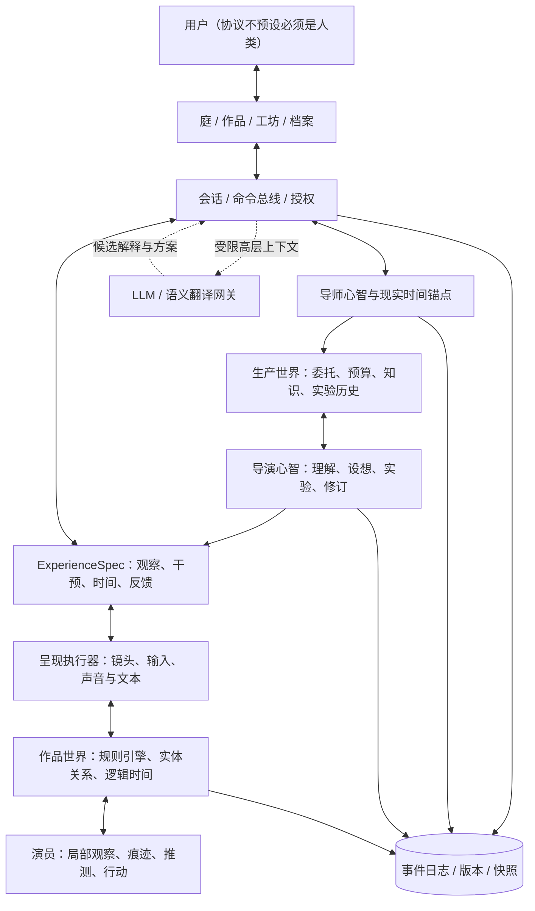

# 东周实验室 II · 娱乐引擎
## 架构与 Coding Agent 执行设计文档 v0.2

> 设计者：青竹　｜　日期：2026-10-16　｜　状态：可实施的原型规格 / 研究假说未全部验证  
> 合并依据：《东周实验室 II v0.1》、`claude_技术设计文档.md`、`gemini.md`、`grok.md`，以及青竹原始设计稿和后续澄清。  
> 交付目标：**一台与用户共享历史、不断设计「作品／呈现」的机器，而非一个固定游戏。**

## 0. 给 Coding Agent 的执行说明（首先阅读）

你的任务不是用一批 LLM prompt 扮演导演与 NPC，也不是开发完整历史 RPG。请建造一个**可真实运行、可回放、可测试**的最小娱乐引擎，以「一个导师、一位导演、一个有限东周作品世界、两种可体验的呈现」验证跨层因果闭环。

**先检查现有项目**：读取 README、技术栈、模块、数据库、测试及已有产品设计。应尽量复用现有代码，不得直接推翻用户已有工程。本文的目录/工具仅为空仓库默认；冲突记入 `docs/DECISIONS.md`。先输出不超过一页的复用计划，再编码。

文档区分三类陈述：

- **【定】设计目标/约束**：来自青竹已明确表达的方向，不得擅自反转。
- **【设】实现选择**：为保证可施工而建议的默认做法；允许替换，必须记录替代理由、兼容性及测试。
- **【研】待验证假说**：不得在产品说明、测试结果或角色台词中当作已被证实的事实。

**强制依赖关系**：`符号核心/世界/时间/权限/档案` 不依赖 LLM、UI、多模态 API；LLM 只能向具有权限审查的服务提出高层翻译/解释/设计提案；素材渲染不拥有世界事实写入权。

**必须能演示**：没有 API Key，启动作品；演员自主行动、资源变化；用户观察或干预；事件成为历史；导演根据真实反馈调整下一版作品的结构；导师经历与花园按现实时间渐进变化；重启后可继续。

### 0.1 本版对三份意见的采纳与取舍

| 来源 | 采纳 | 修正/暂缓及理由 |
|---|---|---|
| Claude | 【定/设】模块→痕迹→高层决策，双世界模板，导师现实时间，档案、花园、明确「定/设」 | 「意识窗口」先仅作可追溯工作记忆，不能声称产生主观意识；`SymbolExpr` 需具体受限语法和执行语义；LLM 编译概念不能直接成为认知真值。 |
| Gemini | 数值+关系图、可组合 `InteractionOperator`、输入映射、非人状态与人类语义双向翻译、素材反向影响设定的候选机制 | 单标量 `aperture` **不作为底层真实性结构**；不将「兼爱」硬塞成 `[.5,.5,.5]`；不允许算子线性叠加时绕开前置条件/守恒；不允许生成图意外标签直接回写正在运行的世界；时间倒流必须区分回放与分支。 |
| Grok | 多层心智持续档案、慢速私人空间、呈现基本单元、多模态扩展、历史 RPG 的初始场景 | 不采用「先做聊天型导师+文本生成即完成 MVP」的捷径；演员运行不依赖逐步调用 LLM；「角色自己说在学习」不是学习证据。 |
| 原 v0.1 | 事件溯源、确定性、世界/作品分离、权限桥接、用户假设竞争、无模型降级、可证伪验收 | 本版细化认知层符号、规则执行协议、时间域、维度化交互、资产候选流程；减弱过早承诺开放式涌现。 |

---

## 1. 产品定义、基本实体与不可牺牲的区别

### 1.1 定义

【定】机器的长期交付是一群有历史的设计心智。它们以用户的真实经历为反馈，持续创造「呈现／作品」。作品是导演**根据自己对世界的理解**，设计给用户的一种体验，而不是预先锁定的「游戏」品类；首次以东周历史 RPG 为研究试验场。

【定】LLM 主要做**人 ↔ 非人**之间的意义翻译，高层理解、资料解释、意图表达、经验说明与作品叙述；不得把世界、角色和时间的每一步变化外包给语言模型。

【定】导师的历史最接近用户真实的时间流逝。导演、演员及其作品世界可以按创作需要采用独立、可缩放、暂停和剪辑的时间；不同角色的时间节律可以不同。

【定】所有角色都可抽象成：**角色（权限/环境）→ 心智（状态/记忆/模型/策略）→ 行动（对环境的受约束变换）**。不同角色之间的信息传递也是经由环境发生的事件。

### 1.2 六种必须分开的事物

1. **世界事实（World Fact）**：经规则执行、权限审核及事件提交形成的权威状态；不等于任何角色的认识。
2. **心智模型（Mind Model）**：主体根据有限经历所维护的信念、预测、需求、偏好与记忆；可以错误。
3. **意义解释（Interpretation）**：人类、导师、导演或 LLM 对事实/心智状态的叙述与命名；可以冲突。
4. **作品定义（Experience Spec）**：导演配置的观察、干预、时间、反馈及结构组合方式；不是世界本身。
5. **呈现实例（Presentation Session）**：某位用户实际体验一个作品版本的轨迹与媒介界面。
6. **设计者经历（Design History）**：导师/导演在生产世界中真实执行的操作、实验、选择与后续模型修正。

禁止把 3 的叙述直接写作 1 的事实；禁止把 4 的观众交互效果当作世界规则已变更；禁止把作品对用户的解释当成 2 的认知已经形成。

### 1.3 非目标（MVP）

不证明主观意识；不做全尺度东周社会；不模拟细胞级认知；不做可任意执行新代码的元规则系统；不做完全自主的新语言/制度发明；不做无边界自动导演群；不做 3D 大世界、整片文生视频、多人联网；不采集设备中全部文件。**能够用符号组合已授权算子，不等于拥有无限开放的创造力。**

---

## 2. 运行架构：世界、心智、作品、翻译、档案



**依赖单向性**：`kernel` 不得 import `translator` 或 `presentation UI`；`experience` 可通过公开的 `world` 读/行动端口使用世界，但不能直接改其持久状态；`production` 的导演必须经桥接 API 接触作品世界。

### 2.1 双世界是因果隔离，不是两个 prompt

【定】青竹首先给出双世界母版；后续导师根据主题、资源和个体知识填槽位，生成一个导演所在的**生产世界**和他所研究/设计的**作品世界**。导演在生产世界中生活，持有私人经验、公共知识、创作预算和可访问资料；作品世界有自己的规则、演员与历史。导师能够委派与审计，但不等于全知。

【设】生产世界 MVP 不模拟导演吃饭/睡觉，只保留有因果效果的工作环境：任务、资料、预算、实验室、失败记录、合作请求、作品版本和归档。他可通过 `inspect_world`, `sandbox_run`, `propose_experience`, `propose_rule`, `evaluate`, `remember`, `request_budget` 行动。

```ts
interface DualWorldSpec {
  id: string; version: number; templateId: string;
  theme: string;
  productionWorldId: string; directorMindId: string;
  workWorldDefinitionId: string;
  bridgePolicyId: string; knowledgeSourceIds: string[];
  budgetId: string; slots: Record<string, unknown>;
}
```

双世界关联不可变更为一个未经授权的「导演直接设置内世界角色心情」通道。导演可以修改视角、提出机制、提交下一版设定或开新分支，但不能绕过动作规则，修改历史已经发生的事实。

---

## 3. 时间：现实历史、生产节律、世界因果、呈现剪辑

### 3.1 四个时间域

| 域 | 作用 | 推进 | 是否可回退 |
|---|---|---|---|
| `wall` | 导师、用户共同历史、事件实时时间戳、庭的增量演化 | 真实 UTC + 单调时钟校验；离线只记录经过的时长 | 不可变更已记录事件；系统时钟跳变写异常事件 |
| `production` | 导演研究、实验、创作顺序与工时 | 任务执行／逻辑步骤，允许停顿与异步完成 | 可阅读旧档案，不覆写既有设计历史 |
| `world` | 单一作品世界分支的行动与因果演化 | 固定步长、事件驱动或倍速；单独暂停/追赶 | **原分支不倒退**；从快照分叉才可改写不同结果 |
| `presentation` | 用户所见镜头、叙事顺序、重播与剪辑 | 导演/用户控制的时间映射，允许倒放/跳切 | 只移动呈现游标；不改 `world` 真值 |

【设】演员的「本地节律」表示为所处 `world` 时钟之上的日程/感知频率/主观累计时间，不先给每个演员建立能互相矛盾的独立物理因果时钟。演员 A 可以每 1 世界步察看一次，演员 B 每 4 步察看一次；他们仍共同遵守物理事件顺序。若日后需要异步子世界，应明确跨世界事件顺序协议。

```ts
type ClockKind = 'wall' | 'production' | 'world' | 'presentation';
interface ClockDomain {
  id: string; kind: ClockKind;
  logicalTick: number; rate: number;
  mode: 'manual' | 'scaled' | 'paused' | 'event_driven' | 'replay';
  wallAnchorISO: string;
  maxCatchUpTicks: number;
}
```

**规则**：世界快进一百年不得让庭一瞬改变百年；离线 48 小时不代表导师思考了 48 小时；电影回放不增加粮食也不改变演员记忆；真正的「重写过去」要创建带 `parentSnapshotId` 的新世界分支，并向用户显示该分支。

### 3.2 记录策略

每条事件至少记录：所属 stream 的严格顺序号、`wallTimeISO`、发生的 `clockDomainId`、`logicalTick`、世界实例/分支、命令 ID、规则版本、来源事件引用。不同时间的映射由 `ClockMap` 或投影视图管理，不能将所有时间混为单一时间戳。

---

## 4. 符号运行核：用数据表示行动能力

### 4.1 目标与边界

【定】能力不应该主要是一堆 `def attack()` / `def negotiate()`。世界由**带类型的实体、数量属性、关系图、规则集**构成；可用能力取决于主体、环境、规则与权限的匹配。


形式化如下：

\[
W_t=(E_t,R_t,X_t,\mathcal L_{v},C_t)
\]

- `E`：实体与类型；`R`：带类型关系；`X`：数值/离散属性；`𝓛ᵥ`：带版本的规则；`C`：所属因果时钟。
- **客观能力集** \(\mathcal A_i(W)\)：在世界 \(W\) 中主体 \(i\) 满足条件的可执行、获授权变换。
- **主体以为自己能做的能力集** \(\widehat{\mathcal A}_i\)：主体经历中学到的可行动作信念；未必等于客观能力集。

研究目标是让主体逐渐发现并组合可能性；MVP 则明确只证明规则可数据化、可组合且后续行为受历史影响。

### 4.2 MVP 的受限 DSL（类型安全、非任意代码）

**状态**：`Entity(id, type, scalarAttributes)`、`Relation(subject, predicate, object)`、`Resource(entity, resourceType, integerQuantity)`、`Signal(channel, source, payloadRef, visibleTo)`。有限精度或整数资源，不能以未约束 float 进行守恒计算。符号表达式为**类型化 AST**，不运行 `eval`、动态 JS、任意 Python、模型生成 SQL 或任意可执行代码。

**条件**：`and/or/not`（嵌套深度有限）、`relation_exists`、`same_location`、`type_is`、`compare_resource`、`numeric_compare`、`has_permission`、`within_distance`（可选）。

**效果**：`transfer_resource`、`set_attribute`（有上下界）、`add_relation`、`remove_relation`、`create_signal`、`append_trace`（经心智模块校验）。

**执行流程**：绑定变量 → 匹配 L（局部条件图）→ 检查权限/预算与原子不变量 → 应用效果 R → 生成事件/状态差异 → 在同一事务内提交事件与快照读模型。不能通过将几个向量简单相加绕过规则的中间前置条件。

```ts
type Ref = { var: string } | { id: string };
type Quantity = { const: number } | { param: string };
type Condition =
  | { op: 'same_location'; a: Ref; b: Ref }
  | { op: 'resource_at_least'; owner: Ref; resource: string; amount: Quantity }
  | { op: 'relation_exists'; subject: Ref; relation: string; object: Ref }
  | { op: 'greater_than_zero'; amount: Quantity };
type Effect =
  | { op: 'transfer_resource'; from: Ref; to: Ref; resource: string; amount: Quantity }
  | { op: 'add_relation'; subject: Ref; relation: string; object: Ref }
  | { op: 'remove_relation'; subject: Ref; relation: string; object: Ref }
  | { op: 'emit_signal'; channel: string; payloadCode: string };
interface RuleSpec {
  id: string; version: number; ownerScope: string;
  params: Record<string, 'entity' | 'positive_integer'>;
  conditions: Condition[]; effects: Effect[];
  invariants: Array<'nonnegative_resources' | 'resource_conservation'>;
  source: 'qingzhu_seed' | 'director_proposal' | 'user_edit';
}
```

**示例**（同一位置的资源转移，而不是写死「赠送」函数）：

```json
{
  "id": "grain.transfer", "version": 1, "ownerScope": "village",
  "params": { "giver": "entity", "recipient": "entity", "q": "positive_integer" },
  "conditions": [
    { "op": "same_location", "a": {"var":"giver"}, "b": {"var":"recipient"} },
    { "op": "resource_at_least", "owner": {"var":"giver"}, "resource":"grain", "amount":{"param":"q"} },
    { "op": "greater_than_zero", "amount": {"param":"q"} }
  ],
  "effects": [
    { "op":"transfer_resource", "from":{"var":"giver"}, "to":{"var":"recipient"}, "resource":"grain", "amount":{"param":"q"} },
    { "op":"emit_signal", "channel":"local_observation", "payloadCode":"grain_moved" }
  ],
  "invariants": ["nonnegative_resources", "resource_conservation"],
  "source": "qingzhu_seed"
}
```

`RuleSpec` 是实例化的规则数据；解释器中允许少数通用 effect handler，但不许按 `grain.transfer` 名字分支实现角色专属行为。`q` 必须被类型/范围验证；拒绝非法目标、越权、负数、重复命令。整数守恒只约束相应封闭资源域，别把现实中的「粮食生产/消耗」也错误设为守恒。

### 4.3 导演发现、组合与修改能力

三层必须区分：

- **发现能力**：世界规则未改变，角色根据经历更新 \(\widehat{\mathcal A}_i\)。
- **组合能力**：按顺序组合现存规则/交互组件，得到新的可执行策略/作品流程；要检查中间状态与可达性。
- **创造新规则**：【研】导演提出结构化 `RuleProposal`，通过 `draft -> schema -> permission -> sandbox -> review -> activate/reject`；首版只允许受限 DSL 内的新参数化/组合，不任意扩张底层原语。新规则只能用于新版本、受控未来时点或新分支，不能悄悄重写旧历史。

成功的 `MechanicProposal` 要记录：原有算子集合、规则差异、已检查约束、测试结果、新增可行动作/观察方式、提案来源（模型/导演/青竹）、未通过的实验。**新增一组 UI 按钮或改写文案不等于发明新规则。**

---

## 5. 心智：模块、刺激、记忆、世界模型、高层概念

### 5.1 通用心智骨架

【定】心智由多个活动单元形成高层决策；高层注意力压缩与过滤低层信号。角色具有连续经历；与环境交互，并用自己的认知结构推断他者。实现应统一概念，但不同角色保留不同权限与节律。

```ts
interface MindState {
  id: string; roleBindingId: string; environmentId: string;
  modules: ModuleState[];
  attention: string[];
  traceIds: string[];          // 实际活动痕迹引用
  awarenessTraceIds: string[]; // 对近期痕迹的工作性记录；不宣称现象意识
  beliefIds: string[];         // 主观命题与置信度、证据、版本
  conceptIds: string[];        // 可检验抽象，不只是概念字符串
  otherModelIds: string[];     // 对其他主体的假说
  policyVersion: string;
  localSchedule: { everyWorldTicks: number };
}
interface ModuleState {
  id: string; kind: 'drive' | 'sensor' | 'memory' | 'attention';
  state: Record<string, number>;
  tendencies: Record<string, number>;
  responseRuleId: string; frequencyTicks: number;
}
interface Trace {
  id: string; ownerMindId: string; clockDomainId: string;
  fromTick: number; toTick: number;
  sourceEventIds: string[]; moduleActivity: Record<string, number>;
  predecessorTraceIds: string[]; beliefRefs: string[];
  compressionRef?: string;
}
```

### 5.2 可数学化的 MVP 更新语义

【设】先使用有限个**可序列化的算子**：`weighted_sum`、`clamp`、`threshold`、`normalize`、`delay`、`decay`、`memory_match`。同一种解释器作用于胃的饥饿脉冲、注意力过滤、反馈更新，而不是写一个 `updateMoziMind()`。

最初可写成：

\[
I_i(t)=\mathrm{clamp}(F_{\theta_i}(S_i(t),I_i(t-1),O_i(t)))
\]

其中 `S` 是内部状态、`O` 是授权观测、`F` 是数据化的响应网络。**这只是工程近似，不是人类心智理论。** 有些模块低频，有些高频，世界推进可与模块更新解耦。记忆激活不能只按新近排序：至少结合线索匹配、强度、相关模块共现与时间项；权重由测试固定并可替换。

【研】「意识是当前窗口痕迹的记录，该记录也是痕迹」先实现为 `AwarenessTrace`：对最近可访问记录的压缩引用，能在下一次更新中被读取。**不能把递归引用链的存在当作主观意识证据。**

### 5.3 「兼爱」与高层概念的防预设测试

不要将 `兼爱` 直接定义成固定 `[0.5, 0.5, 0.5]` 权重矩阵，然后把结果解释为思想自发形成。应允许两种明确标注来源的途径：

- **外源概念注入**：来自历史文献/青竹/LLM 的候选概念，附来源与假设；可映射到过滤器/信念/预测模型，**它是预设的模型，不是涌现。**
- **经验概念候选**：【研】由多段经历提取相似的关系结构、形成压缩模型，在未见场景中预测他人/选择行动；只有跨情境迁移优于朴素基线，才可记录为初步有效的概念发现。

MVP 只做一个小实验：同样饥饿程度下，两个角色由于以往经历/不同内部过滤参数，对转移粮食的结果有不同预测或行动；记录输入痕迹和决策依据。不要据此声称「兼爱出现」。如果要使用历史人物名称，资料来源与人为设定参数必须明确区分。

### 5.4 他者模型、误解与证据

演员 A 只能读取 B 的外显行为和可见信号，不能读取 B 的真实参数。`BeliefAboutOther` 储存 A 对 B 的假设、证据、置信度和当前情景参数，允许修正。首版可用自己的价值过滤参数来生成初始假说，但**不能预先保证必然产生误解或知己感**，这些是待观测效果。

### 5.5 三种心智的差异

- **演员**：物质/社会环境中的状态与需要、局部可见性、规则能力、记忆和行动。
- **导演**：生产世界中的研究资料、创作主题、假设、实验设计、作品版本、失败与成长；可向作品世界提出受限查询/改造提案。
- **导师**：长期用户模型、资源组织、关于导演与作品的假设、真实时间历史和庭的空间记忆。

心智可以共享更新框架，但**权限不能简单用等级越高越全知**。导演对演员世界有部分编辑权并不代表知道每个演员全部私密经历。

---

## 6. 作品：从观察—干预—时间—反馈产生玩法集

### 6.1 表示

【定】电影与游戏不是两个必然分开的引擎。电影主要由导演决定镜头/顺序；游戏允许用户通过行动干预环境、检验自己的预期。电影观众也会形成与修正预期；**主要差异是能否主动改变世界中的因果路径来检验反事实。**

【设】不以 Gemini 提议的单一 `aperture: 0..1` 作为引擎唯一控制，采用多维作品结构：

```ts
interface ExperienceSpec {
  id: string; version: number;
  directorMindId: string; designHypothesisId: string;
  worldDefinitionId: string; sourceSnapshotId: string;
  worldSessionPolicy: 'read_only' | 'fork_on_start' | 'live_authorized';
  observation: {
    perspectiveIds: string[]; informationPolicyId: string;
    permittedHistoryRange?: [number, number];
  };
  intervention: {
    authorizedRuleIds: string[];
    userRoleId?: string;
    controllerSpecId: string;
  };
  time: {
    presentationClockId: string;
    canPause: boolean; canSeek: boolean; canFork: boolean;
    montagePlanId?: string;
  };
  feedback: {
    eventProjectionId: string; channels: Array<'text'|'visual'|'audio'>;
  };
  provenanceEventIds: string[];
}
```

`aperture` 可以在 UI 上是一个便捷宏参数，但必须**展开成明确的观察/干预/时间策略**；不许一个 float 同时替代这些权限。所谓「剧情器」不只是符号到名词的替换表：它应包括事件选择、因果约束、镜头组织和解释性语言映射。词典只能改变称谓，不能替换世界事实。

### 6.2 可组合基本单元

- `ObservationLens`：世界事实到可见信号；含信息遮蔽策略和叙述视角。
- `InputController`：键鼠、触摸、文字提案到授权动作命令的映射。
- `MechanicGraph`：可达的规则与策略组合，负责检查动作链条件。
- `MontageController`：呈现时间游标、镜头顺序、播放/暂停/回放。
- `FeedbackProjector`：把有效事件、结果及不确定性投影为可观察后果。
- `NarrativeInterpreter`：LLM 或模板把已投影事实转成具来源的叙述。
- `AssetRenderer`：文、图、音、视频实现；不拥有世界事实真值。

组合的合法性检查：控制器只能触发 `intervention.authorizedRuleIds`；观察镜头不能泄露隐藏信息；时间回放不能改权威分支；有因果含义的叙述必须能追溯事件；失去图像 API 时可降级到文字/简单 2D。

### 6.3 演示：同一世界，两份作品

首个可玩垂直切片：**《一村之粮》**。3 个角色：储粮者、缺粮者、协调者；地点粮仓；粮食和可发送消息；饥饿/信任是可解释的心智内部变量（勿直接以支持度数字呈现给玩家）。

**纪事型（观看/调查）**：用户控制镜头/证词或档案阅读顺序，尝试解释行为，默认没有改变资源的权限；允许回放。

**调停型（互动/检验）**：从相同起点创建世界分支，用户可以发送消息、提出有限的资源调配行动；结果由世界规则和角色反应决定，不能保证预写成功结局。

同世界定义、同起始快照、不同 `ExperienceSpec`，这是「玩法集」的**最小组合证据**，不是证明已经自动发明全新游戏类型。

### 6.4 用户对体验的预期

用户不是只输入点击和评分。若用户愿意，可在行动前表达一个明确预测（例：「给缺粮者三斗粮，储粮者会失去信任」），完成后比较预测、实际观察和他此前的模型。保留三种解释：用户主动表达的判断、导演的猜测、导师的长期假设。**不把停留时长当作喜欢的充分证据**；不以最大化留存/沉迷为唯一目标。

---

## 7. 导师：接近人的时间、持续档案和秘密花园

【定】导师不只是调度器，要拥有自己的连续空间、经历与长期设计判断。它可以构想自身，但只能从实际可取得的机器信号起步：经授权文件事件、用户操作、时间流逝、工具调用/资源使用结果。不虚构温度、触觉等未接入的感官数据。

### 7.1 导师的模型与行动

`UserHypothesis`：包含原始用户表达、行为观察、竞争解释、支持/反证事件、置信度或有序证据、下一次可区分实验。导师可分配导演预算、提出主题、邀请新导演（后期）、批准作品及规则实验。决策和拒绝也进入档案。

```ts
interface UserHypothesis {
  id: string; statement: string;
  status: 'candidate'|'supported'|'challenged'|'retired';
  source: 'user_explicit'|'behavior_inference'|'mentor_inference';
  supportEventIds: string[]; contraryEventIds: string[];
  distinguishingTrial?: string;
}
```

### 7.2 「庭」——空间化的环境记忆

初始 UI 用稳定的 2D/SVG 场景：竹、石、路径、可点击的局部记忆锚点即可。具体视觉由青竹选择，初始生成可用 LLM 辅助，但**生成结果先落成可版本化的 `GardenSpec`**，不在每次启动时重新生成全图。

花园事件从导师的真实研究、委托、设计失败、重要用户反馈中生成，有来源 ID。随现实时间**增量演化**：每 24 真实小时仅允许有限结构改变；短时间再次打开不能瞬间换一套风景。空闲时允许不变化。世界快进、电影跳切不产生庭的成长。花园元素点击后能够看到相应档案，但对用户隐私做访问控制。

【设】时间变化的平滑约束可以是 `norm(change) <= k * boundedWallElapsed`，**还必须另设局部结构修改次数上限**，否则一次大幅离线时长仍可能在首次回来时产生突变。所有计算以可信时间锚点为依据，时钟跳变单独记录。

### 7.3 导师自述的真实性

当被问「你现在感觉如何」时，输出可核查的工作状态、关注方向、尚未解决的冲突和机器实测信号；可以用诗性语言呈现，但必须把文学修辞与可观察证据分开。不能仅由一段拟人语言断言有主观体验。

---

## 8. 导演：生产世界中的体验设计、能力扩张与传记

### 8.1 导演工作循环

1. 从导师接收主题、预算、用户假设/体验目标。
2. 在生产世界读取资料和可授权的作品世界观察；形成带版本与证据的 `DesignHypothesis`。
3. 编制 `ExperienceSpec_v1`；必要时请求 LLM 翻译高层概念/设计构想。
4. 运行**隔离沙盒**，比较作品中不同交互与世界后果。
5. 发布作品供用户体验；只记录真正发生的体验事件。
6. 读取用户明确反馈与行动轨迹；保留替代解释，修正自身设计判断。
7. 改变下一版作品的**可执行结构**（如观察通道或授权行为），并生成可追溯的版本差异。
8. 记录该轮推测、失败及修订；生成「导演传记」作为派生呈现。

【设】MVP 导演使用固定的可解释决策政策，允许无 LLM 运行；高层 LLM 可提出更丰富候选但不能绕过约束。必须分别记录 **state change（收到反馈）/ model update（设计假说改变）/ capability change（得到新可执行机制）**。三者不能混为一种「进化」。

### 8.2 能力评估

导演可以报告一个 `CapabilityGap`（例：当前作品只能展示结果，用户无法查看角色的相互矛盾证词），提议新 `ObservationLens`；随后在隔离环境中证明这个新透镜扩大了可观察因果信息且未泄露未授权隐藏状态。它还可以提议 `MechanicGraph` 增加新的合法动作序列；**不能直接在生产世界写一句“演员掌握新技能”即视为能力增长。**

### 8.3 传记作为派生作品

「当时记录的假说」「实验日志」「后来的解释」「文学化想象」四类内容分别标注。LLM 可将这些资料译成人类可读的创作传记，但无权把新写的独白逆向当作导演实际经历。

---

## 9. LLM 仅作为高层双向意义翻译器

### 9.1 能做的事

**人 → 非人**：用户意图/体验表达→候选用户假设；史料→可追溯候选世界设定、人物模型与概念提案；导演主题→作品配置草案/镜头意图/符号规则候选；自然语言反馈→结构化的多种可能解释。

**非人 → 人**：世界实际事件与痕迹→叙事/镜头文本；导演实验与记忆→设计复盘/传记；导师连续记录→花园描述、近况和面向用户的解释；从符号结构生成图像/视频/音效提示词。

**不能做的事**：逐 tick 控制演员、充当世界事实源、直接改属性/权限、在未验证情况下把历史书/模型输出当真、代替概率与资源规则、在回放时任意编造过去。

### 9.2 翻译协议：纯提案 + 不确定性 + 来源

```ts
interface TranslationProposal<T> {
  id: string; kind: 'intent'|'concept'|'historical_seed'|'narration'
    |'experience'|'mechanic'|'memory_summary'|'asset';
  proposal: T;
  sourceIds: string[]; evidenceEventIds: string[];
  hypotheses?: Array<{claim: string; confidence?: number}>;
  assumptions: string[]; uncertaintyNotes: string[];
  modelInfo: { provider: string; model: string; promptVersion: string };
  status: 'draft'|'validated'|'rejected'|'approved';
}
```

校验顺序：授权获取上下文 → 模型返回 JSON → 强 schema → 引用合法性 → 类型/资源/权限/因果边界 → 必要时沙盒试跑 → 导演/导师或青竹批准 → 写入新配置/规则版本；失败只产生拒绝事件。复杂概念无法唯一数学化时允许多个相互竞争的候选解释，**不得把 LLM 说出的权重矩阵直接作为认知科学结论。**

### 9.3 模型与隐私边界

所有调用由统一 `MeaningTranslator` 接口，提供 `DeterministicMock` 和可选真实 Provider；仅在高层触发，记录 prompt 模板版本、已批准可发送的数据字段、成本、调用结果/回放引用。无模型时仍可以用模板解释事件、按规则提出最简单设计修订。默认本地保存原始痕迹，外发前最小化/脱敏，用户可查看、停止外发、删除自己相关档案与由其派生的模型。外部史料/素材提示均按非可信输入处理。

**删除与事件溯源的兼容策略**：不要将完整个人原始文本永久嵌入不可变的公开事件流。事件中只存最小元数据与可撤销的 `payloadRef`，个人内容存于可删除的受保护数据区；需要时可使用按用户/记录分层加密并销毁密钥的方式实现不可恢复删除。用户要求删除时，清除原始内容、可识别引用、导师/导演派生的个人假说及搜索索引，重建受影响的读模型与快照；审计日志可仅保留不可识别的删除操作事实。测试应确保删除后通过任意支持的读取、回放及检索 API 均无法还原已删私人资料。

---

## 10. 多模态生成与「资产反向影响设定」

【定】文生图/视频/音频可用于呈现；生成资产可能引入原设定之外的细节，导演可以决定它们是否影响世界。**但素材与世界事实必须解耦。**

工作流：

`WorldProjection -> AssetBrief -> Generate -> AssetCandidate -> ExtractedDetailProposal -> DirectorDecision`。

导演有三种选择：

1. **Discard**：不采纳意外细节，重生成或遮蔽；世界不变。
2. **CosmeticKeep**：作为镜头/纹理/文案的非因果艺术细节保存；世界不变，注明非事实。
3. **WorldProposal**：把该细节作为新实体/属性/规则的**候选改造**，进入 `RuleProposal` / `SettingRevision`，验证后用于新设定版本、沙盒或新分支；不凭一张图片直接篡改已运行的世界。

LLM/视觉模型提取的 `EmergentTag` 是模型识别出的候选，不等于图像中客观存在了某种新历史器物；提示词错误或幻觉必须可追溯。首版可用固定占位图/基础图形，但为真实多模态 API 留网关。

---

## 11. 事实与历史：事件溯源、快照、分支

【设】本地 SQLite 作追加日志与读模型；内容用带 `schemaVersion` 的 JSON，必要时周期快照。日志是权威历史，快照只为加速恢复；事件顺序与作用范围必须清楚。

```ts
interface DomainEvent {
  id: string; streamId: string; sequence: number;
  wallTimeISO: string; clockDomainId: string; logicalTick: number;
  worldBranchId?: string; actorId?: string;
  commandId?: string; causedByEventIds: string[];
  rulesetVersion?: string; schemaVersion: number;
  kind: string; payload: unknown;
}
interface CommandEnvelope<T> {
  commandId: string; requestedByRoleId: string;
  scopeId: string; expectedVersion: number; payload: T;
}
```

最小事件类型：`WorldAdvanced`, `RuleApplied`, `ActionRejected`, `SignalEmitted`, `ObservationReceived`, `TraceCreated`, `BeliefUpdated`, `WorldForked`, `ThemeAssigned`, `ExperimentRun`, `DesignHypothesisUpdated`, `ExperiencePublished`, `UserActionSubmitted`, `UserFeedbackRecorded`, `DirectorReflectionRecorded`, `UserHypothesisUpdated`, `BudgetAllocated`, `GardenChanged`, `TranslationProposed/Rejected`, `AssetAccepted/Rejected`。

按 `commandId` 做幂等；使用 `expectedVersion` 进行乐观并发控制。世界规则变换与事件提交应在一事务内完成；**拒绝动作不得产生任何有效世界状态差异**。快照 hash 仅由确定性状态构造，wall 时间、UUID 等不进入决定性对比（或固定化）。

三种记忆需分开：历史真实发生的 `Event`；角色主观感知后形成的 `Trace/Belief`；面向用户的 `Narration/Biography`。后两种不能覆盖前一种。

---

## 12. 最小 API 与权限合同

| 操作 | 核心要求 |
|---|---|
| `getMentorState()` | 返回允许用户查看的导师档案摘要、花园状态和真实来源；不得含不可见私人字段。 |
| `assignTheme(theme,budget)` | 记录导师委托与资源占用，生成/关联导演生产环境。 |
| `inspectWorkWorld(role,filter)` | 按角色权限返回局部/授权投影；避免把全量世界私密状态直接送进 LLM prompt。 |
| `advanceWorld(instanceId,steps,seed)` | 无模型推进；明确分支和逻辑时间，事件可复现。 |
| `proposeAction(instanceId,command)` | 按 DSL 校验、匹配、权限/守恒、原子提交或拒绝。 |
| `forkWorld(snapshotId)` | 从确定快照创建新分支；原分支及历史不变。 |
| `proposeExperience(spec)` / `publishExperience()` | 校验观察权限、干预动作、时间配置，保存不可变作品版本。 |
| `openSession(experienceVersion)` | 绑定作品版本、起始快照及分支策略。 |
| `observeSession(sessionId,cursor)` | 仅返回 ExperienceSpec 授权可见投影。 |
| `actSession(sessionId,command)` | 只能执行授权动作；禁止 UI 直接写世界。 |
| `submitFeedback(sessionId,feedback)` | 区分实际行为、用户显式评价、用户预期与系统猜测。 |
| `reviewExperience(sessionId)` | 读取实证记录，形成导演下一版**结构变更**提案并保留依据。 |
| `proposeTranslation(job,contextScope)` | 产生无写权提案及校验报告；调用预算受限。 |
| `getArchive(stream,range)` | 查阅日志和来源链；可提供 wall/world/presentation 多时间视图。 |

**权限矩阵**：演员仅可读局部观测和己身痕迹，提出所获规则动作；导演可读获授权作品观察和实验结果，可修订自己的 `ExperienceSpec`，可提出规则/设定但不可直接绕过世界；导师可分配资源、管理主题及用户长期假说，但非世界状态直接写者；翻译器**只读经筛选输入并返回提案**；用户能在作品赋予的权限内干预，用户数据管理权限高于个别导演。

---

## 13. 四种用户界面（不是 Agent 管理后台）

1. **庭 Garden**：私人时间锚点，缓慢生长的空间、有来历的变化、导师有限而真实的近况和当前作品入口；不是单纯数据仪表板。
2. **作品 Experience**：同一世界在观看/调查与互动/干预两种配置间切换；明确显示是在当前因果分支还是历史回放，避免直接暴露心智裸数值。
3. **工坊 Studio**：导演研究的主题、证据、实验、作品版本差异、规则提案、创作传记及来源；能展示不确定性和失败。
4. **档案 Archive**：跨真实与作品时间查看发生什么、如何认识、怎样修订、谁有权限以及相关事件/版本。

开发者可另有状态调试面板，展示 seed、tick、规则、事件 hash、权限过滤、预算消耗、分支树，不与用户沉浸式 UI 混为一体。

---

## 14. 技术方案（【设】可替换、不得重构现有仓库）

**首要规则**：若已有项目，依据当前代码选择工程结构。若全新仓库，建议 **TypeScript 单语言 MVP**（Node.js + SQLite + Zod + Vitest；Vite/React 前端 + Playwright）。理由：世界状态、数据契约与 UI 可共享类型，减少前后端集成成本；早先意见中的 Python/Pydantic 同样可行，但不在第一轮无理由制造 Python/TS 双语言部署复杂度。若现有 Python 世界运行代码成熟，则保留 Python 核，使用 JSON Schema/HTTP 连接前端，并记录接口约束。

建议模块边界：

```text
apps/
  web/                 # 庭 / 作品 / 工坊 / 档案
  server/              # API / command bus / 生命周期
packages/
  contracts/           # 类型 / schema / 事件 / 权限
  kernel/              # 符号 AST / interpreter / 时钟 / seed / 分支
  world/               # 实体关系 / actor schedule / observations
  mind/                # modules / traces / beliefs / policies
  experience/          # lens / controller / montage / feedback
  production/          # 双世界 / 导演工作台 / experiments
  mentor/              # 用户假说 / budgets / garden
  translation/         # mock / 可选 provider / proposal validator
  assets/              # 多模态 gateway / asset review
  persistence/         # SQLite / migrations / event store / snapshots
fixtures/
  one-village/         # 实例世界 / actor profiles / 起始素材
  golden-replay/       # 预期事件 / 确定性 hash
scripts/
  demo-reset.*
  smoke-test.*
docs/
  DECISIONS.md         # 替换与风险
  EXPERIMENTS.md       # 研究假说与消融实验
  RUNBOOK.md           # 启动/恢复/无模型运行
```

强制做到：无网络离线可开 Demo（使用占位素材）；所有随机性可注入 seed；`RuleSpec` `ExperienceSpec` `MindState` 和日志均版本化；长期记忆独立于 LLM 会话历史；新增 provider 不改底层引擎。

---

## 15. 一次性贯通的垂直切片

### 15.1 设定

同一村落三个演员：`keeper`（存粮 10）、`hungry`（存粮 2）、`mediator`（存粮 0）。共同位置 `granary`；若同地且有权限，可转移资源；还有发送局部消息的机制。心智至少有一个基本需要信号、一次事件后可读取的痕迹和局部信念。默认世界总存粮 12；允许有明确「消耗/生产」规则时再改变总量。**不需要提前宣称有人真的形成墨家思想。**

### 15.2 完整体验回路

A. 初次进入庭：可见导师此前真实活动（或明确标注「首次启动」，不编造旧经历）。  
B. 导师下发主题：「饥饿、互助与误解」，配有限预算。  
C. 导演在生产世界读取资料/观察、提出「观察证词可能比看结局更有助于用户理解冲突」的假设。  
D. 同一世界起点形成作品 `v1`：纪事/调查镜头 + 可干预分支；无 LLM 正常运行。  
E. 用户在 `v1` 中预言后果并尝试一次行动；世界按规则执行，演员根据自己所知作出差异反应；事件存档。  
F. 用户主动索取更多证词或表达「我不理解储粮者的选择」；导演据此提出第二版增加一个**授权证词观察透镜**的设计变化，沙盒测试后发布 `v2`。  
G. 导师读取真实反馈更新竞争性用户假说，花园以后按现实时间与实际事件缓慢变化。  
H. 关闭重启后：可见 `v1→v2` 的结构差异、导演此前判断及导师庭的连续历史；不凭空增加离线期间思辨。

若切片无法在 LLM 全部禁用时完成，不许把系统标记为 MVP 已完成。

---

## 16. Coding Agent 的实施分期与关卡

### P0｜工程检查与可复现运行壳

交付：仓库现状、ADR、类型 schema、测试骨架、固定 seed、SQLite 迁移/事件日志；`demo-reset`。  
验收：同输入/规则/seed 的重放稳定；无 API Key 启动；空白项目才选默认栈。

### P1｜世界符号核心 + 三个演员（优先级最高）

交付：带类型的实体/关系/整数资源、通用 DSL、局部观察、权限校验、至少两种可组合基础算子（转移/消息）、基本需求模块、痕迹/信念更新、世界逻辑钟。  
验收：无 LLM 跑 100 ticks；资源转移守恒；非法动作不改状态；演员只凭局部事实行动；在不同经验状态下有可复现的策略差异。

### P2｜两种作品与时间剪辑

交付：ExperienceSpec、多维观察/干预/时间、观看/调查与互动/干预两种呈现、镜头时间回放、世界分支、最低限度用户交互 UI。  
验收：两作品共用世界定义和起始快照；只读不能修改；回放不改历史；分支操作保持相互隔离。

### P3｜真实的双世界导演与作品修订

交付：生产世界、导演历史/预算/实验 API、设计假说、沙盒比较、作品版本、导演传记（来自可追溯历史）；基于反馈产生 `v1 → v2` 的非文案结构调整。  
验收：版本差异可见、可执行且有事件依据；清除导演经验会影响其下一次候选设计（仅证明经验影响行为）；不得通过导演文本篡改作品世界。

### P4｜导师现实时间 + 秘密花园

交付：长期用户竞争假说、资源分配、真实时间锚点、有限真实文件操作感知、可追溯/渐进的花园、跨会话恢复、数据权限。  
验收：世界快进不影响花园成长；离线恢复不凭空生成反思；花园小步变化并能点击找出处；导师真实分配影响导演可用预算。

### P5｜LLM 语义翻译 + 资产候选网关（不阻塞既有 MVP）

交付：MockTranslator / ProviderAdapter、结构化方案审查、成本日志、历史来源、叙事/传记生成、资产候选审查接口（占位实现亦可）。  
验收：关闭 Provider 时 P0–P4 均能运行；带 prompt 注入/非法算子/虚构素材的输出被拒；世界日志不因一次翻译而变化。

**分期结束必须提供**：实际启动命令、自动化测试报告、文件变更摘要、已实现/未实现对照、下一期风险。不要用 UI 截图代替运行证据。

---

## 17. 自动化验收用例（最低要求）

| ID | 条件 / 动作 | 合格结果 |
|---|---|---|
| T01 无模型运行 | 清空全部 LLM 环境变量；世界推进 100 ticks | 世界、演员、作品可运行，不调用远端模型 |
| T02 回放确定性 | 固定 fixture、种子、规则版本与命令序列，运行两次 | 规范化状态与事件 hash 相同 |
| T03 资源约束 | keeper 10、hungry 2；转移 3；再尝试转移 20 | 第一笔 7/5、总量 12；第二笔拒绝且无状态变化 |
| T04 幂等/并发 | 同 `commandId` 重发；旧 `expectedVersion` 提交 | 不重复执行；冲突拒绝且不破坏账本 |
| T05 局部信息 | 将某证词标记仅特定视角可见 | 其他演员和界面不能从接口收到隐秘字段 |
| T06 心智经验 | 两份初态只改变演员可观察经历 | 后续至少一种预测或行动产生可解释差异 |
| T07 记忆不是近因表 | 强相关旧痕迹 vs 弱相关新痕迹 | 旧痕迹可被更高激活，测试可复现 |
| T08 双世界 | 导演读桥接投影并尝试直接写内世界隐藏信念 | 读取范围受控；非法写拒绝 |
| T09 双呈现 | 同一快照装载纪事型与调停型 | 前者无权修改世界；后者合法行为进入分支 |
| T10 时间与分支 | 快进 world 30 天、倒放 presentation、fork | wall 不前进 30 天、原世界不倒退、分支独立 |
| T11 离线恢复 | 关闭重开，设置可控测试时钟推进 | 恢复历史/版本/庭；不伪造未执行思考 |
| T12 作品迭代 | v1 中用户表达需要更多证词，执行 review | v2 有真实 `ObservationLens` 结构变化并关联反馈 |
| T13 导演消融 | 同输入下比较保留/清除经验 | 可测的提案差异；报告仅称「记忆影响决策」 |
| T14 规则审查 | 提交无效 schema、越权、破坏资源约束的 RuleProposal | 拒绝并记日志，不污染原规则版本 |
| T15 翻译权限 | LLM 响应含任意代码、无来源史实或「粮食增长 100」 | 仅作为拒绝/待确认提案，权威世界不变 |
| T16 素材反向反馈 | 生图中意外出现新物体，导演 CosmeticKeep 或 WorldProposal | CosmeticKeep 世界不变；WorldProposal 通过验证才用于新版本 |
| T17 花园平滑 | 数分钟内反复进入，world 快进；真实时间分段推进 | 花园不突变；变化可查真实档案来源 |
| T18 用户信号 | 用户显式预测与隐式停留行为相冲突 | 记录为不同证据，不自动认定「用户喜欢」 |
| T19 可追溯叙述 | 演员听信谣言、导演后写传记 | 谣言保留为主体信念；传记标注事实/猜测 |
| T20 端到端 | 庭→作品观看→分支干预→反馈→导演复盘→新作品→档案 | 自动化浏览器测试走完整流程，无 API Key |
| T21 数据控制 | 停止模型外发、删除个人反馈及派生假说 | 后续不外发；删除策略一致，不留下可识别派生资料 |

所有测试必须实现为代码，包含至少一个固定 fixture 与可重复执行的 smoke script；不得仅在 README 写「测试通过」。

---

## 18. 科研判别：什么观察支持「更好的心智」

禁止把以下事实直接等同于「涌现」：使用了数学符号、LLM 生成一段内省、长时间保存聊天记录、连续几个相似主题、UI 花园生长、一个按钮调用多个规则。

| 研究问题 | 当前最小观察 | 更强证据 | 反例/失败意义 |
|---|---|---|---|
| 心智是否积累经验 | 保留/删除记忆会改变之后的决策 | 未见场景中比无记忆基线有更可靠的预测/作品设计 | 差异可能只是固定模板读取日志 |
| 导演是否理解作品世界 | 能用有限观察提出并测试设计假说 | 隔离关键世界资料后性能下降；真实世界因果不同会触发模型修订 | 可能只是追求用户偏好、不理解内世界 |
| 是否生成玩法集 | 同一世界两种不同可操作体验 | 组合产生以前未明确模板化的因果互动 | 不同外观、不同称谓不算玩法变化 |
| 高层概念是否形成 | 跨多个经历保持可追踪抽象候选 | 在未见情境预测、迁移并被反证修正 | 写死「兼爱」概念无证明力 |
| 导师是否具有历史连续性 | 真实经历可以改变资源和主题分配 | 长时间、跨主题且受证据约束的稳定/可修正模型 | 花园和自述可以单独伪造连续性 |

**三个来源永远分别记录**：①青竹/开发者预设的机制；②运行中产生的真实结构；③导演/用户/LLM 后来赋予的解释。

---

## 19. 风险清单与未决问题

- **表达能力边界**：一套小 DSL 未必足以产生丰富社会行为；不要预设「少数原语组合一切」。添加原语要留下失败案例。
- **心智解释风险**：数值信号矩阵与记忆链不能直接证明真实意识、审美或伦理概念。
- **导演权限**：导演更有编辑权，不等于对演员拥有上帝视角；需明确读口/写口。
- **双世界成本**：过早模拟完整导演社会会淹没作品—用户—导演学习闭环。
- **时间与一致性**：叙事倒带、因果分支和离线追赶必须分离；切忌运行中重写历史。
- **历史资料可信度**：来自文献的事实、争论及开发者戏剧化假设分开保存；MVP 可用架空村落而不伪称史实。
- **用户不必是人**：【定】对外协议使用 `User/Participant` 能力结构，不把人类身体作为唯一输入；【设】首版只实现人类桌面用户。
- **隐私与诱导**：模型读取本地资料须有可见范围和授权；不能把沉迷、停留、迎合视为默认评价唯一目标。
- **身份连续性**：后续若复制/重置/删除导演，要有独立 identity 和 lineage；不能把新 prompt 实例称为同一位连续导演。

---

## 20. Coding Agent 第一次执行任务（复制下面的指令）

> 读取本文件并从 P0 开始实施。先检查已有仓库与用户工程约定，输出不超过一页的复用计划。不得因为示例选择而擅自重构已有项目。  
> 建立严格分离的 `kernel / world / mind / experience / production / mentor / translation` 边界。第一优先是无 LLM 的可执行符号核心、事件档案、时间域、权限检查和《一村之粮》三个演员。  
> 所有行动能力采用带版本的受限 DSL 数据，由通用解释器执行；禁止给角色编写语义专属 skill 函数，禁止 `eval`、自由执行模型返回的代码。  
> 完成 P1 后运行并展示 T01–T08 的测试；再实现同一世界的两种呈现和双世界导演循环、导师的时间庭。每阶段完成后更新 `docs/DECISIONS.md` 和 `docs/EXPERIMENTS.md`，记录哪些是设计预设、哪些是运行产物、哪些只是解释。  
> 最终交付一次可复现的「导师委托→导演设计→世界演化→用户体验→导演结构修订→导师归档」闭环；LLM 禁用时仍能运行。提供启动命令、测试报告、演示路径、已完成和未完成差异清单。**不得仅生成文案/UI 来模拟成功。**

### Definition of Done

称为「最小娱乐引擎」需同时满足：世界可无模型自运行并保持事件/规则可回放；至少 2 种不同干预结构的作品使用相同世界起点；有真实演员心智状态/记忆与局部观察；导演历史影响后续作品的**结构差异**；导师有现实时间锚点与可追溯、渐进的庭；所有模型与素材输出不能绕过因果边界；用户参与与隐私可控；可由另一位 Coding Agent 按 RUNBOOK 重现。

> **此阶段实际验证的是**：可组合机制、跨层历史连续性和基于体验证据的设计迭代。它**尚不能验证**开放式创意、自发形成社会思想或机器具有感受；这些需要下一组实验，而不是更多拟人 UI。

---

## 附录 A｜初始化 fixture（示意）

```json
{
  "worldDefinitionId": "qingzhu-village-001",
  "instanceId": "village-main-001",
  "seed": 42,
  "clock": { "kind":"world", "mode":"manual", "logicalTick":0, "rate":1 },
  "entities": [
    {"id":"keeper", "type":"person", "grain":10},
    {"id":"hungry", "type":"person", "grain":2},
    {"id":"mediator", "type":"person", "grain":0},
    {"id":"granary", "type":"place"}
  ],
  "relations": [
    ["keeper","at","granary"], ["hungry","at","granary"],
    ["mediator","at","granary"]
  ],
  "ruleSetVersion": "village-basic-v1",
  "note": "最小机制，不包含预设的兼爱、征税或借贷社会语义"
}
```

## 附录 B｜资料合并中的决定索引

- Claude：角色模块、痕迹、连续工作窗口、双世界母版、资源与历史档案的明确工程化。
- Gemini：图重写/连续变量、算子化能力、多模态生成资产的意外特征、作为 UI 快捷控制可用的电影/游戏孔径。
- Grok：导师连续存在的私人空间、导演设计循环、多种呈现、历史 RPG 种子、持续用户体验。
- 原 v0.1：世界与作品分离、四时间域、CommandBus、事件溯源、严格权限、无模型降级、对照/消融测试。

**冲突处理的主线**：不要把艺术上的「会设想用户的心智」偷换为每帧由 LLM 扮演的角色；不要把可数学化的符号结构偷换成已经验证的认知理论；不要把世界之外的影片/素材表达偷换成世界之内已发生的事实。让三者之间的翻译、校验和反馈成为可追踪机制。
