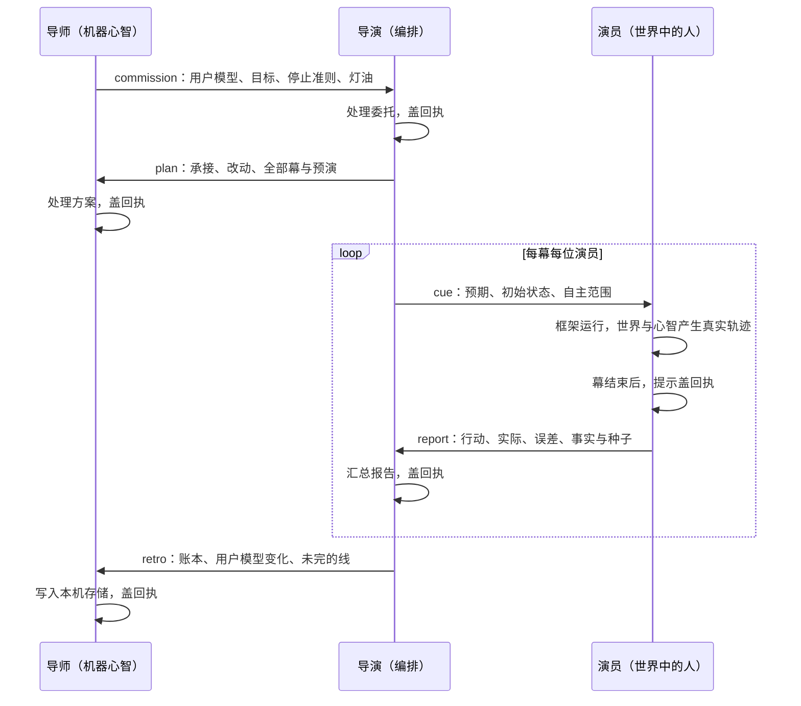

# 三层信息流：导师、导演、演员

## 怎么在游戏里看见它

以前只能展开面板读信，现在咖啡厅左侧的工作案会把本次信件按四个焦点演出：导师的委托帛书 → 叔衡读信、盖收件印并钉真实幕序 → 提示飞到演员板，收件时亮灯 → 报告竹简回来，接住才盖导演回执。原座位、导师和门的位置不变。独立入口 `intents/studio.json` 先走过《旱》，随后进入工作室；五十年长卷则在 `chronicle-306` 与 `return` 之间进入同一幕。

打开 `runs/studio/2/L1/index.html`，在工作室拿起帛书、点大印、接竹简即可验证，Enter 也走同一动作。一个可复验的小例子：竹简的“预演：给粟；实际：拒绝”来自这一次《旱》的报告；若原件没有 error，案上的误差淡痕就不画。每屏只显示18字以内的原文摘录，演员板只添禾、季、田伯四字姓名，全文可在面板看。

按反引号展开“三层信息流”，找到第二轮 commission/plan，再看 `act=studio` 的 cue/report；提示里的 `initialState.sourceReport` 指向原局报告，报告的 actual 与 error 保持原值。最初的启动回执早已存在，工作室不会改写它：第二轮是重新交付本次委托与复核原局回报，印落下时才调用 receive。启动器生成的工作室结束报告也保留，所有真实信件只增不覆盖。

在 `runs/studio/2/L1/layers.json` 看 `letters/check/counts`，完整收场应为 `check: []`；`trace.jsonl` 中 `layer.letter` 可核对落印时刻，`director.compare` 可核对原局来源，`world.fact` 看两次实际收件事实。`shots/*-studio-*.png` 是四个焦点；长卷的 `history-save.json.completed.studio` 表示已归档，下次进入会续过，不再次写入。没有既有演出的自测上下文只报告实际收件，不会编造演员偏离；中途退出不会保存半幕进度。元素与动作的完整映射见 `frameworks/studio/README.md`。

2026-10-15 S6最终验收：typecheck通过；studio / seed 2 / L1与插入后的fifty-years / seed 3 / L1均重新present完成并bench hard 9/9，最长一屏分别28与29字、0错误，notext/repro/layers全通过。studio共25封信（2委托、2方案、10提示、10报告、1回顾），长卷共43封（2委托、2方案、19提示、19报告、1回顾），均无未回执且check=[]。正式产物来源核对脚本与真实第二次来访均通过；完整命令、结果、截图编号、未支持边界见工作室README的“S6正式交付记录”。

以前只能看见按幕播放，无法检查是谁把什么交给了谁。现在每次启动都有委托和方案，每位被识别出的演员都有提示和报告，结束后导演把事实与未完的线交回导师。所有信件在收件人处理后才有回执；演出中缺报告或回顾属于尚未完成，不能提前判通过。



图旁的复验小例子：first-visit / seed 7 / L1 的 `cue:han:1` 预期“田伯开门后说的和心里预演的不一样”，`report:han:1` 实际为“预演：给粟；实际：拒绝”；回顾来自真实账本：“《旱》交付：禾献了种粟。雨没来，人都来了。”两封信不能用互相覆盖的方式抹掉预期误差。

## 去哪里看

- 打开管线生成的 `runs/first-visit/7/L1/index.html`，按反引号（键位在数字 1 左边）；手机可长按舞台左下角一秒。找到“三层信息流”，有五类数量、未回执数、检查结果，以及按发出时间排列的每封信。✓ 表示已处理，○ 表示尚未处理。
- 控制台：`window.__zhuzi.layers.letters()` 与 `window.__zhuzi.layers.check()`。演出中检查会列出未完成项；全部结束后应为 `[]`。
- 管线产物：`runs/<intent>/<seed>/<tier>/layers.json`，形状是 `{ letters, check, counts }`；本次 first-visit 为 15 封（委托 1、方案 1、提示 6、报告 6、回顾 1），未回执 0；han-act1 为 9 封。
- `trace.jsonl` 或 `window.__trace` 中筛选 `kind === 'layer.letter'`。每次发送与盖回执分别追加一个不可变快照（`phase: sent / received`），信在 `event.letter` 中；按信件 id 取最后一个快照即可还原最终收件状态。

## 规则与边界

`engine/layers/bus.ts` 生成编号与 `performance.now()` 时刻，有世界时钟时同时记 day。`send` 不盖章；`receive` 校验收件人，重复接收不会重写首次回执。对外返回副本，不能借改一封已取出的信去改审计记录。运行时用 `usePlan` 登记真实幕名，bench 再从产物 plan 或页面 plan 独立取得幕名，防止信件自己宣称覆盖自己。

检查要求五类齐全、每封信都有合法回执、提示与同幕同演员的报告配对、先委托后方案、方案覆盖全部幕、每幕有提示、回顾在全部报告及其回执之后、所有幕引用存在；同时检查重复编号、时间倒序、收发层与 payload 中的角色/幕一致。缺一封演员报告、去掉回执、写假幕、方案漏幕、提前回顾均会失败。

导师只读本机 `visit.last` 和真实感官：来访次数、称呼、距上次多久、结局、停留最久的位置、时段、设备与机器力气。`why` 有按 seed/来访次数选择的三种首访与回访说法；久别会明确说隔了几天。灯油由 tier、机器力气、深夜、设备与首访负担相乘得出。本次浏览器复验：初访宽屏灯油 0.8；预置四次来访、八天前离开、上次借粟且停在井，第五次的 `why` 为“隔了8天，先接回上次的线。”、灯油 1；手机初访灯油 0.6。测试记忆仅写入隔离浏览器上下文。

`direct()` 的方案、ack 与 cues 只取输入数据，不读真实时钟；同文件同 seed 完全一致。真实委托在浏览器启动、演示面板处理重开 seed 之后计算，再交给同一个纯函数 `acceptCommission`。方案文件中的 ack 是待委托版本；真正发送并处理的 ack、真实用户模型，以 `layers.json` 为准。

演员从幕的元素、角色 id/名字与台词说话人推导；“四季”不当作演员“季”。`initialState` 带 seed、角色、焦点和世界配置，运行框架使用同一方案。报告只取当前幕的 `res.data.facts`、`world.fact`、说话/动作与 `mind.*`（含 audit 中的 mind、误差与精度）；没有个人行为证据就明说，不把预期当事实。禾的未发芽/已发芽种子从真实世界快照提取。

回顾去重汇总真实账本，列出没有被触碰的可操作元素；写入 `visit.last` 与 `mentor.last`。若玩家在演出里选择“忘掉我”，本次回顾的写回部分为空，收场不会偷偷恢复记忆。

bench 只新增 `layers` 硬检查，旧八项判定与门槛原样保留。没有导演方案、也没有任何信件的通用测量夹具（good/bad.html）明示 `layers skipped`；有 plan 的作品即使移除整个 layers 接口也必须检查，并从 `layer.letter` 轨迹兜底。无轨迹则失败。

## 五种真实信件摘录

下列字段从本次 `runs/first-visit/7/L1/layers.json` 原值摘录；方案略去 rehearsal，提示略去 initialState.world，报告只列最后两条事实，回顾略去 mentor.last 的完整事实 id 列表。完整信件仍在产物中，未改动其值来配示例。

### 委托

```json
{
  "id": "commission:visit:1",
  "kind": "commission",
  "from": "mentor",
  "to": "director",
  "t": 24.80000001192093,
  "payload": {
    "intentId": "first-visit",
    "title": "第一次来访",
    "hypothesis": {
      "id": "h-first-visit",
      "text": "你会为一个人的处境停下来，并想知道他后来怎样",
      "mode": "probe"
    },
    "target": "推门、被认出、拿起《旱》、住进禾的心、回到咖啡厅被回应、带着一条没收口的线离开",
    "stop": "你关上门",
    "budget": {
      "tier": "L1",
      "lamp": 0.4,
      "note": "深夜·宽屏·第1次来；夜深收短，4幕"
    },
    "userModel": {
      "visits": 1,
      "sinceLastMs": 0,
      "dayPart": "深夜",
      "device": "宽屏"
    },
    "why": "初次见面，先给你一件再问。"
  },
  "receipt": {
    "at": 25,
    "by": "director"
  }
}
```

### 方案

```json
{
  "id": "plan:visit:1",
  "kind": "plan",
  "from": "director",
  "to": "mentor",
  "t": 25,
  "payload": {
    "planId": "first-visit",
    "version": 1,
    "director": {
      "id": "base",
      "name": "基础导演"
    },
    "acts": [
      {
        "id": "threshold",
        "framework": "vignette",
        "author": "基础导演",
        "focus": "door"
      },
      {
        "id": "reveal",
        "framework": "reveal",
        "author": "叔衡",
        "focus": "east-suburb"
      },
      {
        "id": "han",
        "framework": "walk2d",
        "author": "叔衡",
        "focus": "he"
      },
      {
        "id": "return",
        "framework": "vignette",
        "author": "基础导演",
        "focus": "ticket"
      }
    ],
    "accept": "接下这4幕，按事实交付。",
    "changes": [
      "深夜灯油减半；保留既定幕序，让每幕可及时离开"
    ]
  },
  "receipt": {
    "at": 25,
    "by": "mentor"
  }
}
```

### 提示

```json
{
  "id": "cue:han:1",
  "kind": "cue",
  "from": "director",
  "to": "禾",
  "act": "han",
  "t": 9691.300000011921,
  "payload": {
    "act": "han",
    "who": "禾",
    "expects": "田伯开门后说的和心里预演的不一样",
    "freedom": "按自身心智、所见事实与世界压力行动；可以偏离导演预期",
    "constraints": [
      "门永远推得开",
      "你永远能对机器说话",
      "你永远能回到上一版",
      "地标不动：你的座位、导师的位置、通往世界的门",
      "已交付的版本只增不改",
      "不得把预演写成已发生的事实",
      "每屏最多30字"
    ],
    "initialState": {
      "seed": 7,
      "focus": "he",
      "person": {
        "id": "he",
        "name": "禾",
        "role": "actor",
        "home": "home"
      }
    }
  },
  "receipt": {
    "at": 62326.09999996424,
    "by": "禾"
  }
}
```

### 报告

```json
{
  "id": "report:han:1",
  "kind": "report",
  "from": "禾",
  "to": "director",
  "act": "han",
  "t": 62326.30000001192,
  "day": 11,
  "payload": {
    "act": "han",
    "who": "禾",
    "did": [
      "处理本幕提示；观察到39条交付事实",
      "说：社公在上，种粟献你。",
      "kneel",
      "offer-seed"
    ],
    "predicted": "田伯开门后说的和心里预演的不一样",
    "actual": "预演：给粟；实际：拒绝",
    "error": {
      "layer": "mind",
      "note": "预演：给粟；实际：拒绝"
    },
    "ms": 52634,
    "seeds": [
      {
        "id": "s1",
        "concept": "tianbo",
        "strength": 0.8,
        "plantedDay": 10,
        "sprouted": true,
        "blockedBy": "抹不开脸"
      },
      {
        "id": "s2",
        "concept": "she",
        "strength": 0.85,
        "plantedDay": 10,
        "sprouted": true,
        "blockedBy": "祷了又祷"
      }
    ],
    "facts": [
      {
        "id": "f38:sacrifice",
        "text": "禾在社坛献上了来年的种粟，乡邻聚来。",
        "kind": "commit"
      },
      {
        "id": "f39",
        "text": "《旱》交付：禾献了种粟。雨没来，人都来了。",
        "kind": "delivery"
      }
    ]
  },
  "receipt": {
    "at": 62326.5,
    "by": "director"
  }
}
```

### 回顾

```json
{
  "id": "retro:visit:1",
  "kind": "retro",
  "from": "director",
  "to": "mentor",
  "t": 70148.69999998808,
  "day": 11,
  "payload": {
    "intentId": "first-visit",
    "predicted": "推门、被认出、拿起《旱》、住进禾的心、回到咖啡厅被回应、带着一条没收口的线离开",
    "actual": "《旱》交付：禾献了种粟。雨没来，人都来了。",
    "promises": [
      "threshold：导师：机器的心智，正写完手上那一笔，尚未亲手碰过",
      "reveal：临淄此刻：低分辨率，人退回统计，尚未亲手碰过",
      "reveal：田缝，尚未亲手碰过",
      "reveal：天：望天，尚未亲手碰过"
    ],
    "next": "下次从threshold：导师：机器的心智，正写完手上那一笔，尚未亲手碰过接起",
    "userModelDelta": {
      "visit.last": {
        "n": 1,
        "at": 1792072911499,
        "dwell": {
          "door": 325,
          "ticket": 182,
          "east-suburb": 143,
          "walk2d-place-home": 0,
          "walk2d-place-field": 0,
          "walk2d-place-well": 0,
          "walk2d-place-altar": 0,
          "walk2d-place-gate": 0,
          "walk2d-place-road": 0,
          "walk2d-sky": 0,
          "walk2d-rumor": 0,
          "walk2d-offer-accept": 0,
          "walk2d-offer-decline": 0,
          "walk2d-commit": 0,
          "walk2d-he": 287,
          "walk2d-gate-ring": 1618,
          "heart-approach": 4433,
          "heart-go": 1267,
          "heart-weight-qing": 2167,
          "heart-weight-li": 4950,
          "heart-weight-ming": 2150,
          "heart-write": 286,
          "heart-close": 879,
          "heart-editor-close": 0,
          "name": 145,
          "pen": 0,
          "seat-lamp": 534
        },
        "seed": 7,
        "name": "客",
        "ending": "sacrifice",
        "endingFact": "禾在社坛献上了来年的种粟，乡邻聚来。"
      },
      "mentor.last": {
        "intentId": "first-visit",
        "ending": "sacrifice",
        "reports": 6,
        "predictionErrors": 1
      }
    }
  },
  "receipt": {
    "at": 70148.80000001192,
    "by": "mentor"
  }
}
```

## 复验

```sh
pnpm typecheck
pnpm present --intent intents/first-visit.json --tier L1 --seed 7
pnpm bench runs/first-visit/7/L1
pnpm present --intent intents/han-act1.json --tier L1 --seed 3
pnpm bench:selftest
```

除了上述验收，已对真实信件做七种损坏验证（丢报告、无回执、错误幕名、方案漏幕、方案假幕、方案早于委托、提前回顾），全部被拒绝；trace 回放还原的信件与 layers.json 完全相同。同 seed 的纯导演重复计算也完全一致。面板已用真实浏览器按反引号验证。

## 最终验收汇总

- `pnpm typecheck` → `tsc --noEmit`，退出 0，全仓无类型错误。
- `pnpm present --intent intents/first-visit.json --tier L1 --seed 7` → `layers 15 封信 · 未回执 0 · 检查通过`；`play done 28 步 · 71.2s · 截图 13 · trace 414 条 · 报错 0 · 账本 39 条`；目录状态 `ok`。
- `pnpm bench runs/first-visit/7/L1` → `PASS hard 9/9 · first-action 0.04s · first3s 1 · feedback p90 358ms · max-chars 29 · errors 0 · fps-p5 60 · notext PASS · repro PASS · layers PASS`。
- `pnpm present --intent intents/han-act1.json --tier L1 --seed 3` → `layers 9 封信 · 未回执 0 · 检查通过`；`play done 24 步 · 57.1s · 截图 7 · trace 388 条 · 报错 0 · 账本 40 条`；目录状态 `ok`。
- `pnpm bench:selftest` → `selftest PASS · 校验器与 bench 都判得出好坏`（好夹具 PASS，坏夹具 FAIL）。

完整演出后的浏览器面板也实测 `PANEL COMPLETE true 15封信`，且“提示 6 / 报告 6 / 未回执 0”同时可见。可以按上方五条命令重做，再按反引号查看；无需手改任何产物。

## 追加授权：旧字数检查的叠字修复

首轮真实 bench 为 `FAIL hard 8/9`：三层已通过，DOM 测到 33 字（trace 单句只有 19 字）。只读浏览器采样定位到心象工具常驻 22 字，叠上“押田地：禾猜他要买地。”11 字，并非新面板的隐藏问题。协调者随后通过 orchestration ask 回复，明确追加授权 `components/heart/labels.ts` 的 rehearsalText/changedFrom 文案缩短、最多 15 行、不得改行为与接口。

实际只删去重复来由前缀：默认“禾猜他要买地。”7 字，另换来由时“禾另猜他要买地。”8 字，保留这是禾在猜。修改限于函数内三行；未触碰原字数判定与门槛。面板原有 `[hidden]` 与 `display:none` 已实测不参与字数采样。

## 修改文件

- `engine/layers/types.ts`、`bus.ts`、`mentor.ts`、`report.ts`：冻结协议、收发与检查、导师、报告归纳。
- `engine/types.ts`：只增 Plan 的 commission/ack/cues 类型。
- `director/pipeline/director.ts`、`mentor.ts`、`present.ts`：纯函数承接与提示、管线信件产物。
- `app/main.ts`、`app/context.ts`：运行时收发、回执、存储与上下文。
- `components/presenter.ts`：可见审计面板。
- `bench/run.ts`、`bench/thresholds.json`：只加 layers 检查与开启项。
- `components/heart/labels.ts`：上述追加授权的三行文案修复。
- `docs/design/layers.md`：本说明与可复验证据。

## 本波没有做

- 信件是规则与数据的协作记录，不调用模型；灯油是委托中的预算说明，本波未扩展 think 引擎为硬限额执行器。
- 演员的自由由现有世界/心智/框架执行，本波不改这些引擎；提示留在 ctx.layers 与 handoff.actorCues，未增加演员模型的实时对话协议。
- 中途关闭、框架出错或 `--no-play` 不会伪造完整回顾；`--no-play` 仅构建，不产生一次完整演出的 layers.json。
- 框架只按既有主角/元素角色规则识别演员；新小游戏与五十年长卷的注册和编排属于下一波整合，未在本任务越界改动。
- 本机存储不可用时沿用 Store 的内存退路，不支持跨设备同步。
